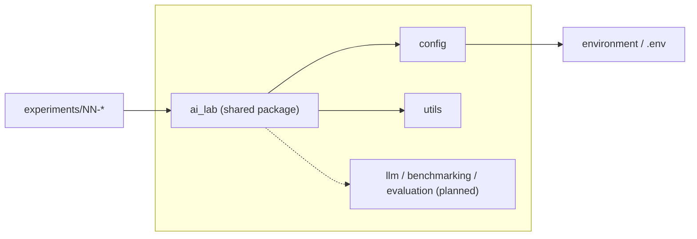

# Architecture Overview

The repository is a monorepo of independent experiments plus a thin shared Python package, `ai_lab`. Each experiment lives under `experiments/NN-*` and can be understood and run on its own.

## Dependency rule

Experiments may import `ai_lab`. `ai_lab` must never import from experiments.

## Experiment dependencies

Experiment-specific dependencies are added only when the experiment is implemented. For each experiment, decide between a root dependency group and a separate project, and record the decision in an [ADR](../decisions/README.md).

## Promoting shared code

Code moves into `ai_lab` only once a second experiment needs it. Until then it stays inside the experiment that owns it.

## Current contents of `ai_lab`

- `config`: typed settings from environment variables and `.env`, with lazy credential checks.
- `utils`: logging configuration.
- `llm`, `benchmarking`, `evaluation`: placeholders, intentionally empty.
