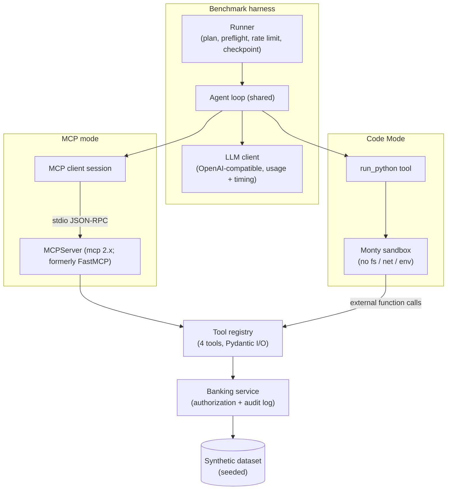

# 01 — MCP vs Code Mode

> **Status:** Phase 4 — benchmark pipeline complete and verified offline; real run pending
> **Experiment version:** 0.1.0
> **Last updated:** 2026-11-01

## 1. Overview

This experiment compares Model Context Protocol (MCP) tool calling with programmatic tool orchestration ("Code Mode": the model writes code that calls tools via an API inside a sandbox) for the same workflow. It uses a synthetic banking workflow, the same model, the same tools and the same security controls in both modes. The goal is to show when each approach is the better engineering choice, measured on tokens, latency, estimated cost and answer accuracy.

Terminology used throughout:

- **MCP mode:** the model calls tools exposed by an MCP server; every tool result enters the model context.
- **Code Mode:** the model gets one tool, `run_python`, and writes a script that calls the same tools inside a sandbox; only the script's return value enters the model context.
- **Scenario A (simple lookup)** and **Scenario B (chained aggregation)**.
- **Volume:** transactions per account in Scenario B. The dataset has 10, 50, 100 and 200; the measured run uses 10 and 100.
- **Cell:** one (scenario, volume, mode) combination. The measured run has 6 cells.
- **Task:** one execution of one cell.

## 2. Research Question

For an equivalent multi-step tool workflow, how do MCP-based tool calling and Code Mode differ in context overhead, token consumption, latency, reliability and security posture, and at what workflow shape and data volume does the difference become material?

## 3. Why This Matters

As the number of tools grows, so does the context a model must carry. The choice of approach affects cost, latency and attack surface. Every intermediate tool result in MCP mode is re-sent to the model on each later turn, so cost and latency can grow with both step count and payload size.

## 4. Hypotheses

Pre-registered. All hypotheses are unverified. The 25% threshold in H1 was fixed before any run, and results will be reported whether or not they support the hypotheses.

- **H1 (parity on simple lookups):** For Scenario A, mean total tokens and p50 latency differ by less than 25% between modes.
- **H2 (token savings on chaining):** For Scenario B, Code Mode uses fewer total tokens than MCP mode at every measured volume, and the gap widens as volume increases.
- **H3 (latency):** For Scenario B, Code Mode has lower p50 latency at the largest measured volume (100 in the measured run). At the smallest volume the difference may be small.
- **H4 (accuracy):** MCP mode accuracy at the largest measured volume is lower than at the smallest, because the model aggregates large tool outputs in-context; Code Mode accuracy stays stable (max - min across measured volumes at most 0.10), with failures dominated by code errors rather than arithmetic errors.

## 5. Objectives

Compare the two approaches across these dimensions:

1. Architecture
2. Tool discovery
3. Tool execution
4. Authentication
5. Authorization
6. Context overhead
7. Token consumption
8. Latency
9. Reliability
10. Security
11. Scalability

Tokens, latency, estimated cost, accuracy and reliability are measured quantitatively. Discovery, authentication, security and scalability are assessed qualitatively from the implementation.

## 6. Scope

### In scope

A simulated banking account information workflow using synthetic data only, with five capabilities:

1. Retrieve customer information
2. Retrieve customer account details
3. Retrieve account balances
4. Retrieve recent transactions
5. Generate a customer account summary

Both approaches must eventually run equivalent workflows under equal security assumptions:

- Authentication
- Authorization
- Tool access restrictions
- Input validation
- Execution timeouts
- Error handling
- Audit logging

For Code Mode, generated code runs only in a sandbox with filesystem restrictions, network restrictions, resource limits, execution timeouts, restricted credentials and explicit tool allowlists. Authorization is enforced by the banking simulation, never by the LLM.

Two scenarios (details in [benchmarks/methodology.md](benchmarks/methodology.md)):

- **Scenario A — Simple lookup:** retrieve the available balance of one account.
- **Scenario B — Chained aggregation:** for one customer and a fixed 90-day window, retrieve balances and transactions across 4 accounts and compute per-account spend by category, large debits and the total balance, at 10, 50, 100 and 200 transactions per account in the dataset. The measured run uses volumes 10 and 100 only (maintainer decision before any measured run); volumes 50 and 200 are not measured. Canary observations at volume 200 are recorded in [methodology section 3](benchmarks/methodology.md#3-controls).

### Out of scope

- Real banking data or systems
- Production deployment
- Remote MCP transports and OAuth (stdio only)
- Multi-model comparison
- Production hardening

## 7. Architecture

Both modes share one agent loop, one tool registry, one banking service (which enforces authorization and writes the audit log) and one LLM client. Only the toolset differs. The full design is in [architecture/overview.md](architecture/overview.md).



## 8. Implementation Approaches

### MCP mode

An MCPServer (mcp 2.x; formerly FastMCP) exposes the 4 registry tools over stdio and is started once per run. The client lists tools once and passes their schemas to the model. Multiple tool calls per turn are allowed. Every tool result is serialised as compact JSON and appended to the conversation.

### Code Mode

The model receives one tool, `run_python(code)`, and Python function stubs generated from the registry. Code runs in a warm Monty sandbox with the 4 tools exposed as host-bound external functions. Only the script's return value is sent back to the model. Script errors are returned to the model, which may retry within the turn limit.

### Shared by both

- Agent loop
- Tool registry
- Banking service
- Security controls
- LLM client

## 9. Technology Stack

| Component | Choice | Reason |
|---|---|---|
| Language | Python 3.12 | Repository standard |
| LLM access | `openai` SDK against OpenRouter's OpenAI-compatible API | Model-agnostic; provider-reported token usage |
| Model | OpenRouter free model with tool-calling support, set via `LLM_MODEL` | Chosen at Phase 4 from the live model list |
| Agent loop | Hand-written (~150 lines), shared by both modes | Full visibility of every token ([ADR-0004](../../docs/decisions/0004-hand-rolled-agent-loop.md)) |
| MCP | Official `mcp` Python SDK, MCPServer (mcp 2.x; formerly FastMCP), stdio transport | Reference implementation |
| Code Mode sandbox | `pydantic-monty` | In-process isolated interpreter; no filesystem, network or env access ([ADR-0005](../../docs/decisions/0005-monty-code-mode-sandbox.md)) |
| Analysis | `pandas` | Aggregation and percentiles |
| Charts | `matplotlib` | Static PNG/SVG |
| Packaging | uv workspace member | [ADR-0003](../../docs/decisions/0003-experiment-as-uv-workspace-member.md) |

## 10. Experimental Methodology

- 6 measured cells: Scenario A x {MCP, Code Mode} and Scenario B x {10, 100} x {MCP, Code Mode}. The dataset also contains volumes 50 and 200, which are not part of the measured run (see [methodology section 3](benchmarks/methodology.md#3-controls)).
- 10 iterations per cell (60 measured tasks), plus one unmeasured warm-up task per mode.
- Same model, temperature 0, same turn limit, same dataset and principal in both modes.
- Cells run interleaved in a seed-shuffled order per iteration, so provider drift affects both modes equally.
- Ground truth is computed by plain Python, never by an LLM; a task is correct only if every value matches.
- A first-run reliability protocol (offline dry run, preflight, canary, checkpointing, budget guard) protects the limited free-tier request budget.

Full details: [benchmarks/methodology.md](benchmarks/methodology.md).

## 11. Evaluation Metrics

| Metric | Measured / estimated | Source |
|---|---|---|
| Input, output, reasoning, total tokens per task | Measured | Provider-reported usage |
| Model calls and tool calls per task | Measured | Agent loop |
| End-to-end latency (mean, p50, p95) | Measured | Wall clock |
| Latency breakdown (model, tool/sandbox, overhead) | Measured | Step timers |
| Accuracy and partial score | Measured | Scoring vs ground truth |
| Success / failure rate by outcome | Measured | Outcome counts |
| Code-error retries (Code Mode) | Measured | Agent loop |
| Estimated cost per task and per 1,000 tasks | **Estimated** | Tokens x paid-tier price snapshot (or labelled reference price) |
| Peak prompt size per task | Measured | Max prompt tokens over calls |

See [benchmarking standards](../../docs/standards/benchmarking-standards.md).

## 12. Results

> Results pending. Do not fill in until benchmarks have been run.

## 13. Analysis

> Results pending. Do not fill in until benchmarks have been run.

## 14. Limitations

Known in advance:

- Single model.
- Measured volumes are 10 and 100 only; behaviour at 50 and 200 is not measured. See [methodology section 3](benchmarks/methodology.md#3-controls) for the scope decision and single-run canary observations at volume 200 (not measured statistics).
- Free-tier provider routing adds latency variance.
- stdio MCP transport only (no network hop).
- n=10 per cell makes p95 close to the sample maximum.
- Monty runs a Python subset.
- Synthetic data.
- Cost is estimated, not billed.

## 15. Conclusion

> Results pending. Do not fill in until benchmarks have been run.

## 16. How to Run

Set `OPENROUTER_API_KEY` and `LLM_MODEL` in `.env` (see `.env.example`). The model id is never set in the repository. Benchmark settings live in [`configs/benchmark.yaml`](configs/benchmark.yaml).

```bash
uv run mcp-vs-code-mode plan                 # request estimate, no network
uv run mcp-vs-code-mode dry-run              # whole schedule offline against a scripted oracle model, then publish
uv run mcp-vs-code-mode preflight            # config, model, pricing, key tier, MCP server, sandbox (no model request)
uv run mcp-vs-code-mode preflight --live     # same, plus exactly one model request
uv run mcp-vs-code-mode canary               # one task per canary cell against the provider
uv run mcp-vs-code-mode run                  # the full benchmark
uv run mcp-vs-code-mode run --resume RUN_ID  # continue a halted run
uv run mcp-vs-code-mode publish RUN_ID       # analyze + charts + report + LinkedIn images, no requests
```

`publish` is `analyze`, `charts`, `report` and `linkedin-assets` in one go; each can also be run on its own. All of them read only the raw files of the run, so they can be repeated at any time without new model requests. Artefact locations for a run `RUN_ID`:

| Artefact | Location |
|---|---|
| Processed summary | `results/processed/RUN_ID/summary.json`, `cells.csv`, `comparisons.csv` |
| Charts (PNG and SVG) | `results/charts/RUN_ID/` |
| Markdown report | `results/reports/RUN_ID/report.md` |
| LinkedIn images | `linkedin/visual-assets/RUN_ID/linkedin-landscape.png`, `linkedin-portrait.png` |

Dry-run artefacts live together under `results/dry-run/RUN_ID/` (`raw/`, `processed/`, `charts/`, `reports/`, `linkedin/`), are gitignored, and are watermarked `SIMULATED DATA — NOT A RESULT`. The report leaves its interpretation, trade-off and conclusion sections as marked author placeholders.

Safety rails:

- Requests are throttled to 15 per minute (the free-model limit is 20) and the tool stops at a daily cap of 900 requests (the provider limit is 1,000). Requests already used today are counted from the key-info endpoint.
- `canary` must pass before the full run; it exits non-zero on any infra error, invalid answer or turn-limit hit.
- The runner halts cleanly on a daily-limit signal, auth, missing-model or bad-request errors, three consecutive infra errors, or when fewer requests remain than one task could use. Every finished task is already on disk, so `run --resume` repeats only `infra_error` tasks.
- `run` refuses a dirty git tree unless `--allow-dirty`, so results map to a commit.
- `dry-run` writes to the gitignored `results/dry-run/` and makes zero model requests; its output is simulated and not a measurement.

## 17. References

- Model Context Protocol — https://modelcontextprotocol.io
- Cloudflare, "Code Mode: the better way to use MCP" — https://blog.cloudflare.com/code-mode/
- Anthropic, "Code execution with MCP" — https://www.anthropic.com/engineering/code-execution-with-mcp
