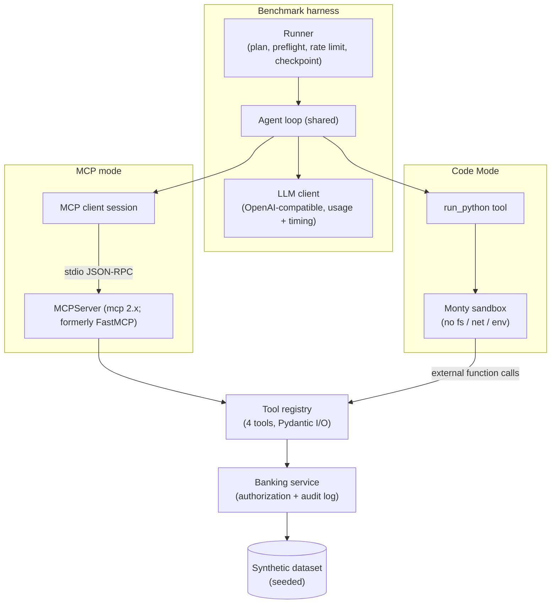
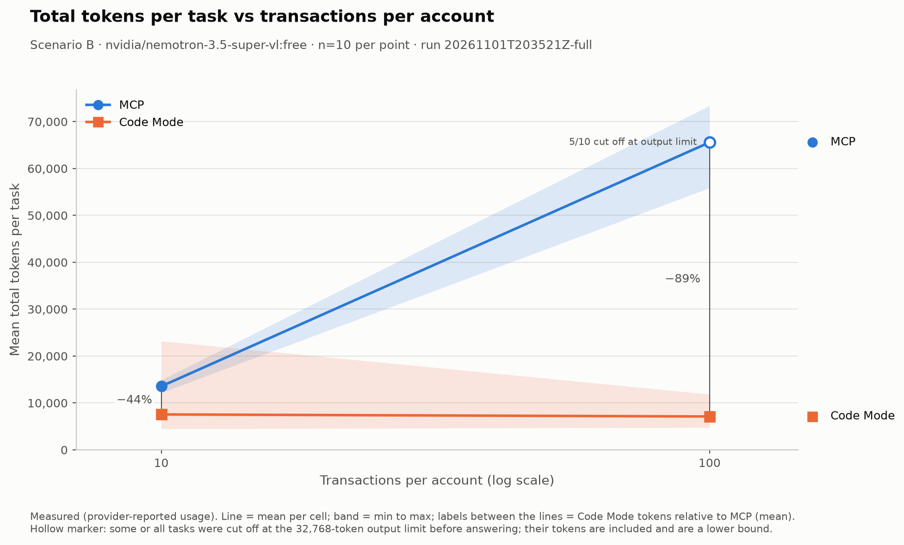
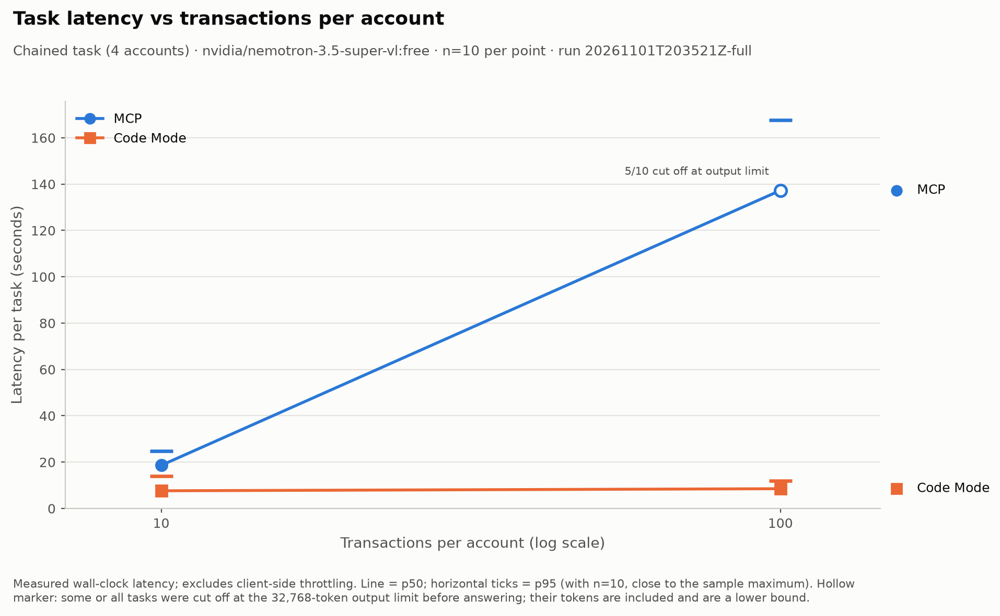
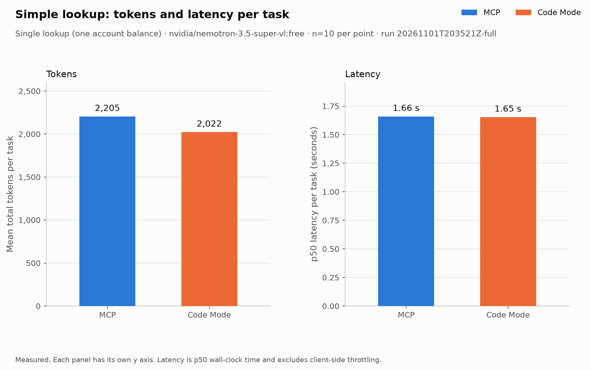

# 01 — MCP vs Code Mode

> **Status:** Complete — measured run `20261101T203521Z-full`
> **Experiment version:** 0.1.0
> **Last updated:** 2026-11-02

## 1. Overview

This experiment compares Model Context Protocol (MCP) tool calling with programmatic tool orchestration ("Code Mode": the model writes code that calls tools via an API inside a sandbox) for the same workflow. It uses a synthetic banking workflow, the same model, the same tools and the same security controls in both modes. The goal is to show when each approach is the better engineering choice, measured on tokens, latency, estimated cost and answer accuracy.

Terminology used throughout:

- **MCP mode:** the model calls tools exposed by an MCP server; every tool result enters the model context.
- **Code Mode:** the model gets one tool, `run_python`, and writes a script that calls the same tools inside a sandbox; only the script's return value enters the model context.
- **Scenario A (simple lookup)** and **Scenario B (chained aggregation)**.
- **Volume:** transactions per account in Scenario B. The dataset has 10, 50, 100 and 200; the measured run uses 10 and 100.
- **Cell:** one (scenario, volume, mode) combination. The measured run has 6 cells.
- **Task:** one execution of one cell.

## 2. Research Question

For an equivalent multi-step tool workflow, how do MCP-based tool calling and Code Mode differ in context overhead, token consumption, latency, reliability and security posture, and at what workflow shape and data volume does the difference become material?

## 3. Why This Matters

As the number of tools grows, so does the context a model must carry. The choice of approach affects cost, latency and attack surface. Every intermediate tool result in MCP mode is re-sent to the model on each later turn, so cost and latency can grow with both step count and payload size.

## 4. Hypotheses

Pre-registered. All hypotheses are unverified. The 25% threshold in H1 was fixed before any run, and results will be reported whether or not they support the hypotheses.

- **H1 (parity on simple lookups):** For Scenario A, mean total tokens and p50 latency differ by less than 25% between modes.
- **H2 (token savings on chaining):** For Scenario B, Code Mode uses fewer total tokens than MCP mode at every measured volume, and the gap widens as volume increases.
- **H3 (latency):** For Scenario B, Code Mode has lower p50 latency at the largest measured volume (100 in the measured run). At the smallest volume the difference may be small.
- **H4 (accuracy):** MCP mode accuracy at the largest measured volume is lower than at the smallest, because the model aggregates large tool outputs in-context; Code Mode accuracy stays stable (max - min across measured volumes at most 0.10), with failures dominated by code errors rather than arithmetic errors.

## 5. Objectives

Compare the two approaches across these dimensions:

1. Architecture
2. Tool discovery
3. Tool execution
4. Authentication
5. Authorization
6. Context overhead
7. Token consumption
8. Latency
9. Reliability
10. Security
11. Scalability

Tokens, latency, estimated cost, accuracy and reliability are measured quantitatively. Discovery, authentication, security and scalability are assessed qualitatively from the implementation.

## 6. Scope

### In scope

A simulated banking account information workflow using synthetic data only, with five capabilities:

1. Retrieve customer information
2. Retrieve customer account details
3. Retrieve account balances
4. Retrieve recent transactions
5. Generate a customer account summary

Both approaches must eventually run equivalent workflows under equal security assumptions:

- Authentication
- Authorization
- Tool access restrictions
- Input validation
- Execution timeouts
- Error handling
- Audit logging

For Code Mode, generated code runs only in a sandbox with filesystem restrictions, network restrictions, resource limits, execution timeouts, restricted credentials and explicit tool allowlists. Authorization is enforced by the banking simulation, never by the LLM.

Two scenarios (details in [benchmarks/methodology.md](benchmarks/methodology.md)):

- **Scenario A — Simple lookup:** retrieve the available balance of one account.
- **Scenario B — Chained aggregation:** for one customer and a fixed 90-day window, retrieve balances and transactions across 4 accounts and compute per-account spend by category, large debits and the total balance, at 10, 50, 100 and 200 transactions per account in the dataset. The measured run uses volumes 10 and 100 only (maintainer decision before any measured run); volumes 50 and 200 are not measured. Canary observations at volume 200 are recorded in [methodology section 3](benchmarks/methodology.md#3-controls).

### Out of scope

- Real banking data or systems
- Production deployment
- Remote MCP transports and OAuth (stdio only)
- Multi-model comparison
- Production hardening

## 7. Architecture

Both modes share one agent loop, one tool registry, one banking service (which enforces authorization and writes the audit log) and one LLM client. Only the toolset differs. The full design is in [architecture/overview.md](architecture/overview.md).



## 8. Implementation Approaches

### MCP mode

An MCPServer (mcp 2.x; formerly FastMCP) exposes the 4 registry tools over stdio and is started once per run. The client lists tools once and passes their schemas to the model. Multiple tool calls per turn are allowed. Every tool result is serialised as compact JSON and appended to the conversation.

### Code Mode

The model receives one tool, `run_python(code)`, and Python function stubs generated from the registry. Code runs in a warm Monty sandbox with the 4 tools exposed as host-bound external functions. Only the script's return value is sent back to the model. Script errors are returned to the model, which may retry within the turn limit.

### Shared by both

- Agent loop
- Tool registry
- Banking service
- Security controls
- LLM client

## 9. Technology Stack

| Component | Choice | Reason |
|---|---|---|
| Language | Python 3.12 | Repository standard |
| LLM access | `openai` SDK against OpenRouter's OpenAI-compatible API | Model-agnostic; provider-reported token usage |
| Model | OpenRouter free model with tool-calling support, set via `LLM_MODEL` | Chosen at Phase 4 from the live model list |
| Agent loop | Hand-written (~150 lines), shared by both modes | Full visibility of every token ([ADR-0004](../../docs/decisions/0004-hand-rolled-agent-loop.md)) |
| MCP | Official `mcp` Python SDK, MCPServer (mcp 2.x; formerly FastMCP), stdio transport | Reference implementation |
| Code Mode sandbox | `pydantic-monty` | In-process isolated interpreter; no filesystem, network or env access ([ADR-0005](../../docs/decisions/0005-monty-code-mode-sandbox.md)) |
| Analysis | `pandas` | Aggregation and percentiles |
| Charts | `matplotlib` | Static PNG/SVG |
| Packaging | uv workspace member | [ADR-0003](../../docs/decisions/0003-experiment-as-uv-workspace-member.md) |

## 10. Experimental Methodology

- 6 measured cells: Scenario A x {MCP, Code Mode} and Scenario B x {10, 100} x {MCP, Code Mode}. The dataset also contains volumes 50 and 200, which are not part of the measured run (see [methodology section 3](benchmarks/methodology.md#3-controls)).
- 10 iterations per cell (60 measured tasks), plus one unmeasured warm-up task per mode.
- Same model, temperature 0, same turn limit, same dataset and principal in both modes.
- Cells run interleaved in a seed-shuffled order per iteration, so provider drift affects both modes equally.
- Ground truth is computed by plain Python, never by an LLM; a task is correct only if every value matches.
- A first-run reliability protocol (offline dry run, preflight, canary, checkpointing, budget guard) protects the limited free-tier request budget.

Full details: [benchmarks/methodology.md](benchmarks/methodology.md).

## 11. Evaluation Metrics

| Metric | Measured / estimated | Source |
|---|---|---|
| Input, output, reasoning, total tokens per task | Measured | Provider-reported usage |
| Model calls and tool calls per task | Measured | Agent loop |
| End-to-end latency (mean, p50, p95) | Measured | Wall clock |
| Latency breakdown (model, tool/sandbox, overhead) | Measured | Step timers |
| Accuracy and partial score | Measured | Scoring vs ground truth |
| Success / failure rate by outcome | Measured | Outcome counts |
| Code-error retries (Code Mode) | Measured | Agent loop |
| Estimated cost per task and per 1,000 tasks | **Estimated** | Tokens x paid-tier price snapshot (or labelled reference price) |
| Peak prompt size per task | Measured | Max prompt tokens over calls |

See [benchmarking standards](../../docs/standards/benchmarking-standards.md).

## 12. Results

Measured run [`20261101T203521Z-full`](results/raw/20261101T203521Z-full/) on `nvidia/nemotron-3.5-super-vl:free` (served by Nvidia via OpenRouter), commit `3af3f6a`: 60 measured tasks (10 per row) plus 2 warm-ups, 172 model requests, 0 failed requests, 0 infrastructure errors. Full report: [`results/reports/20261101T203521Z-full/report.md`](results/reports/20261101T203521Z-full/report.md). Processed data: [`results/processed/20261101T203521Z-full/`](results/processed/20261101T203521Z-full/).

| Scenario | Mode | Correct | Mean total tokens | p50 latency | p95 latency | Mean model calls | Est. cost / 1,000 tasks |
|---|---|---|---|---|---|---|---|
| A: simple lookup | MCP | 10/10 | 2,205 | 1.66 s | 1.9 s | 2.0 | $0.38 |
| A: simple lookup | Code Mode | 10/10 | 2,022 | 1.65 s | 3.2 s | 2.0 | $0.36 |
| B: chained, 10 tx/account | MCP | 10/10 | 13,555 | 18.62 s | 24.8 s | 3.6 | $3.47 |
| B: chained, 10 tx/account | Code Mode | 10/10 | 7,554 | 7.63 s | 14.0 s | 2.8 | $1.69 |
| B: chained, 100 tx/account | MCP | 0/10 | 65,579 | 137.29 s | 167.8 s | 3.5 | $19.21 |
| B: chained, 100 tx/account | Code Mode | 10/10 | 7,117 | 8.52 s | 12.0 s | 2.9 | $1.66 |

Tokens and latency are measured (provider-reported usage; wall clock excluding client-side throttling). Cost is **estimated** at the paid list price of the same model captured on 2026-11-01; the free tier cost nothing. With n=10, p95 is close to the slowest run.

Of the 10 MCP tasks at 100 transactions per account, 5 were cut off at the 32,768-token output limit while still reasoning (their tokens are included and are a lower bound) and 5 returned well-formed answers containing arithmetic errors (mean field-level score 0.41 across all 10).

Pre-registered hypotheses ([criteria](benchmarks/methodology.md#10-hypothesis-evaluation-criteria)), computed automatically:

| | Hypothesis | Verdict |
|---|---|---|
| H1 | Simple lookups: tokens and p50 latency within 25% | Supported (tokens −8.3%, latency −0.4%) |
| H2 | Chained: Code Mode uses fewer tokens, gap grows with volume | Supported (gap 6,001 → 58,462 tokens) |
| H3 | Chained: Code Mode faster at the largest volume | Supported (8.5 s vs 137.3 s at 100) |
| H4 | MCP accuracy drops with volume; Code Mode stays stable | Supported (MCP 100% → 0%; Code Mode 100% at both) |







More charts (cost, accuracy, model calls, latency distribution, token breakdown) are in [`results/charts/20261101T203521Z-full/`](results/charts/20261101T203521Z-full/).

## 13. Analysis

**Where the tokens go.** In MCP mode every tool result is appended to the conversation, so the prompt grows with the data: at 100 transactions per account the final prompt averaged 35,153 tokens. More striking is the output side: MCP tasks at that volume averaged 26,793 output tokens, of which 25,919 were reasoning tokens. The model was not just reading the transactions; it was trying to add them up in its head. In Code Mode the same rows never reach the model. The script loops, filters and sums inside the sandbox and returns a few hundred characters, so total tokens stayed flat at about 7,000 whether an account had 10 or 100 transactions.

**Why MCP got the answers wrong.** The model fetched the right data in every MCP run (all balances and transactions, zero tool errors). The failures happened afterwards: either it ran out of output budget mid-reasoning, or it produced totals that were off by anything from a few cents to over 3,000. This is a property of asking a language model to do exact arithmetic over hundreds of numbers in context, not of the MCP protocol itself. A stronger model would likely do better on accuracy; the token growth would not go away, because it follows from where the data flows.

**Where latency comes from.** Tool and sandbox execution took milliseconds in both modes (mean under 0.05 s per task); the MCP server connected once in about 0.4 s and the sandbox warmed up in about 0.03 s. Almost all task time is model time, so latency tracks tokens: 137 s vs 8.5 s at 100 transactions per account.

**Where Code Mode costs more.** Code Mode was less predictable on the small chained task: between 2 and 5 model calls per run, and total tokens from 4,473 to 23,221, because the model sometimes inspected the data first or had to fix a runtime error in its own code. It also needs a real sandbox (here: no file, network or environment access, time, memory and host-call limits, credentials kept on the host) and a model that writes working code. For the simple lookup it brought no measurable benefit.

**Engineering trade-offs.**

| Prefer MCP tool calling when | Prefer Code Mode when |
|---|---|
| The agent makes a few calls with small results | The task chains several calls together |
| The model mainly reads data rather than computing over it | Results are large and need filtering or aggregation |
| You want a standard integration with no code execution to secure | Exact numbers matter and you can run code in a proper sandbox |
| Predictable call counts matter more than token efficiency | Token cost and latency grow with data volume |

These are complementary rather than competing: Code Mode in this experiment calls exactly the same tools, with the same authorisation, as the MCP server. The difference is only who processes the tool results: the model, or code the model wrote.

## 14. Limitations


- Single model (`nvidia/nemotron-3.5-super-vl:free`) with the provider's default reasoning behaviour; accuracy results in particular are model-specific.
- Measured volumes are 10 and 100 only; behaviour at 50 and 200 is not measured. See [methodology section 3](benchmarks/methodology.md#3-controls) for the scope decision and single-run canary observations at volume 200 (not measured statistics).
- Free-tier provider routing adds latency variance.
- stdio MCP transport only (no network hop).
- n=10 per cell makes p95 close to the sample maximum.
- Monty runs a Python subset.
- Synthetic data.
- Cost is estimated, not billed.

## 15. Conclusion

For a single lookup, MCP tool calling and Code Mode performed the same on tokens, latency and correctness, so the simpler MCP approach is the sensible default there. Once the task chained several calls over larger results, Code Mode used 44% fewer tokens at 10 transactions per account and 89% fewer at 100, was about 16 times faster at 100 (8.5 s vs 137 s median), and stayed correct (10/10) while MCP mode failed every run (0/10).

The practical takeaway is not to replace MCP, but to recognise the point where an agent stops *looking up* data and starts *processing* it. Before that point, direct tool calls are simpler. After it, letting the model write code against the same tools is cheaper, faster and more reliable, provided the code runs in a properly restricted sandbox.

These results come from one model, synthetic data and 10 runs per scenario. The direction of the token and latency effect follows from the architecture and should generalise; the exact accuracy numbers are model-specific and should be re-tested with other models.

## 16. How to Run

Set `OPENROUTER_API_KEY` and `LLM_MODEL` in `.env` (see `.env.example`). The model id is never set in the repository. Benchmark settings live in [`configs/benchmark.yaml`](configs/benchmark.yaml).

```bash
uv run mcp-vs-code-mode plan                 # request estimate, no network
uv run mcp-vs-code-mode dry-run              # whole schedule offline against a scripted oracle model, then publish
uv run mcp-vs-code-mode preflight            # config, model, pricing, key tier, MCP server, sandbox (no model request)
uv run mcp-vs-code-mode preflight --live     # same, plus exactly one model request
uv run mcp-vs-code-mode canary               # one task per canary cell against the provider
uv run mcp-vs-code-mode run                  # the full benchmark
uv run mcp-vs-code-mode run --resume RUN_ID  # continue a halted run
uv run mcp-vs-code-mode publish RUN_ID       # analyze + charts + report + LinkedIn images, no requests
```

`publish` is `analyze`, `charts`, `report` and `linkedin-assets` in one go; each can also be run on its own. All of them read only the raw files of the run, so they can be repeated at any time without new model requests. Artefact locations for a run `RUN_ID`:

| Artefact | Location |
|---|---|
| Processed summary | `results/processed/RUN_ID/summary.json`, `cells.csv`, `comparisons.csv` |
| Charts (PNG and SVG) | `results/charts/RUN_ID/` |
| Markdown report | `results/reports/RUN_ID/report.md` |
| LinkedIn images | `linkedin/visual-assets/RUN_ID/linkedin-landscape.png`, `linkedin-portrait.png` (generated locally, gitignored) |

Dry-run artefacts live together under `results/dry-run/RUN_ID/` (`raw/`, `processed/`, `charts/`, `reports/`, `linkedin/`), are gitignored, and are watermarked `SIMULATED DATA — NOT A RESULT`. The report leaves its interpretation, trade-off and conclusion sections as marked author placeholders.

Safety rails:

- Requests are throttled to 15 per minute (the free-model limit is 20) and the tool stops at a daily cap of 900 requests (the provider limit is 1,000). Requests already used today are counted from the key-info endpoint.
- `canary` must pass before the full run; it exits non-zero on any infra error, invalid answer or turn-limit hit.
- The runner halts cleanly on a daily-limit signal, auth, missing-model or bad-request errors, three consecutive infra errors, or when fewer requests remain than one task could use. Every finished task is already on disk, so `run --resume` repeats only `infra_error` tasks.
- `run` refuses a dirty git tree unless `--allow-dirty`, so results map to a commit.
- `dry-run` writes to the gitignored `results/dry-run/` and makes zero model requests; its output is simulated and not a measurement.

## 17. References

- Model Context Protocol — https://modelcontextprotocol.io
- Cloudflare, "Code Mode: the better way to use MCP" — https://blog.cloudflare.com/code-mode/
- Anthropic, "Code execution with MCP" — https://www.anthropic.com/engineering/code-execution-with-mcp
