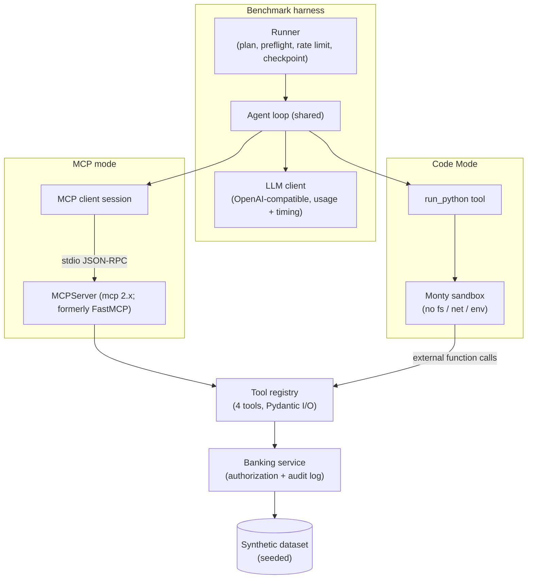
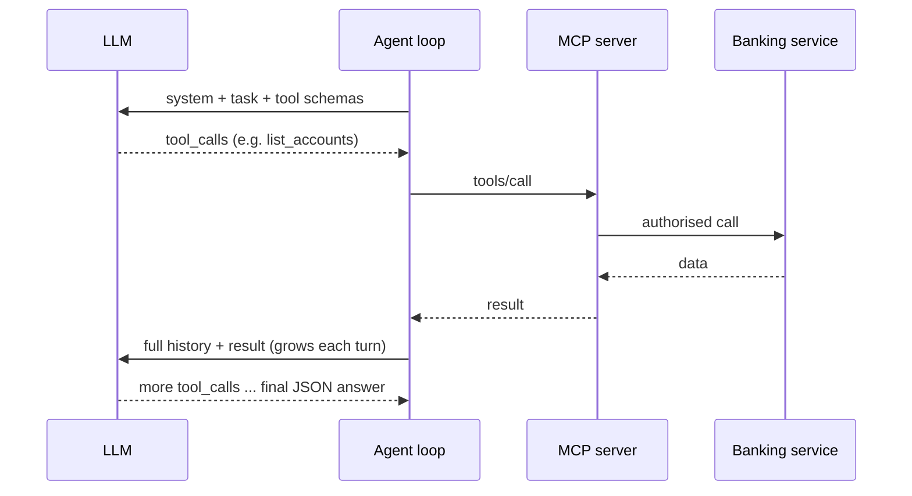
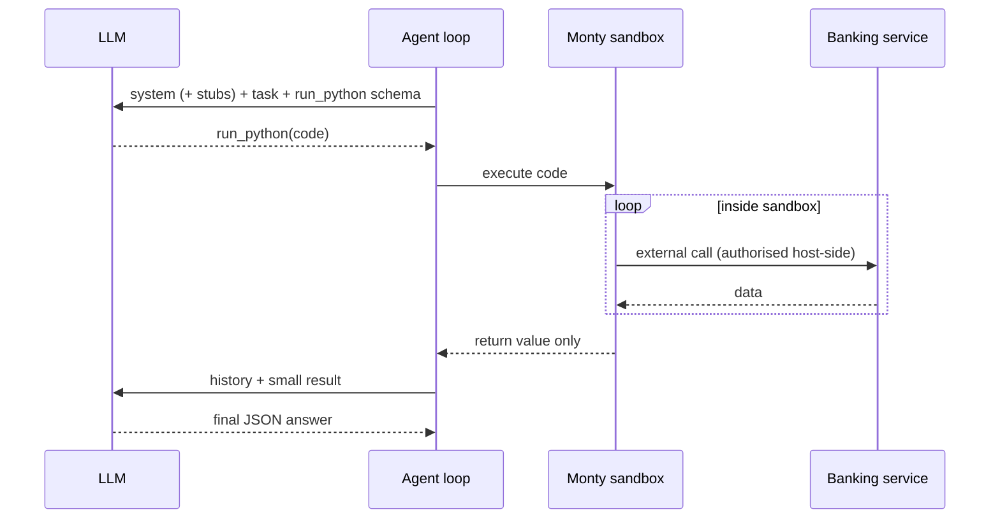

# Architecture — MCP vs Code Mode

Design approved; implementation pending (Phase 2+).

## 1. High-level diagram



## 2. Shared components

### Synthetic dataset
Deterministic generator with a fixed seed. Reference date `2026-10-01`.
- One customer per volume level (volume 10, 50, 100, 200), each with 4 accounts (for example current, savings, credit card, joint current).
- Each account has exactly *volume* transactions dated within the analysis window `2026-07-03` to `2026-10-01` (90 days inclusive).
- Transaction fields: `transaction_id, date, amount (negative = debit), currency, merchant, category, description`.
- A fixed set of 6 categories.
- A small number of debits above 1,000 per account, placed deterministically.
- At least one customer the principal is NOT authorised for (used in authorization tests).

### Banking service
The only component that reads data. Every method takes a `Principal` and enforces that the principal may access the requested customer or account, independent of the LLM. It raises a typed `AuthorizationError`. For every call, allowed or denied, it writes an audit record to JSONL: timestamp, principal, channel (`mcp` or `code_mode`), tool, arguments, outcome, duration_ms.

### Tool registry
Single source of truth for 4 tools. Each tool has a name, description, Pydantic input model, Pydantic output model and handler.

| Tool | Input | Output |
|---|---|---|
| `get_customer` | `customer_id` | id, name, segment |
| `list_accounts` | `customer_id` | list of account_id, type, currency |
| `get_balance` | `account_id` | account_id, available_balance, ledger_balance, currency, as_of |
| `get_transactions` | `account_id, start_date, end_date` | list of transactions |

**Aggregation tool (extension 01b).** The registry also defines a fifth, server-side tool, `summarise_spending(account_id, start_date, end_date, large_debit_threshold=1000)`, kept apart as `AGGREGATION_SPEC` / `AGGREGATION_TOOL_SPECS`. It returns per-category debit sums, the ids of debits above the threshold and the debit count. It goes through the same authorisation, validation and audit path as the raw tools (`BankingService.summarise_spending`). A `ToolExecutor` carries an explicit allowlist of specs: the raw MCP server and Code Mode use the 4 raw tools; the aggregation MCP server (spawned with `BANK_ENABLE_AGGREGATION=1`, audit channel `mcp_agg`) uses all 5. Code Mode never gets the aggregation tool, so the third mode (`mcp_agg`) differs from raw MCP only by that one extra tool.

Both modes derive their tool interface from the registry: MCP tool schemas and Code Mode function stubs are generated from the same names, descriptions and models. This guarantees parity. The fifth business capability, "generate customer account summary", is the agent's final answer, not a tool.

### LLM client
Thin wrapper over the `openai` SDK. Records per call: latency, prompt and completion tokens as reported by the provider, reasoning tokens if reported, the serving provider name if returned, finish reason, request id and retry count. Retries only transport errors (HTTP 429/5xx/timeouts) with exponential backoff, max 3 attempts; retries are recorded.

### Agent loop (shared)
Identical for both modes; only the toolset differs.
1. `messages = [system, user]`.
2. For turn in 1..`MAX_TURNS` (8): call the LLM with the toolset and record it. If there are tool calls, execute each and append the results; otherwise parse the final answer and stop.
3. The final answer must be a JSON object matching the scenario's answer schema (inside a json code fence, or raw). Parse failure gives outcome `invalid_answer`.
4. Outcomes: `correct`, `incorrect`, `invalid_answer`, `max_turns`, `infra_error` (provider failure after retries).

### Configuration
`LLM_MODEL`, `LLM_TEMPERATURE` (0), key and base URL from `ai_lab` settings; benchmark parameters from `configs/benchmark.yaml`.

## 3. MCP mode

- An MCPServer (mcp 2.x; formerly FastMCP) exposes the 4 registry tools over stdio. It is started once per benchmark run (warm), not per task; a cold start is measured separately once and reported.
- The server resolves its principal at startup from a scoped session token passed via environment variable; the token never appears in prompts or tool results.
- The client calls `list_tools` once per run and converts MCP tool schemas into the LLM `tools` parameter.
- Multiple tool calls in one model turn are allowed and executed in order (current best practice; avoids a strawman baseline).
- Every tool result is serialised as compact JSON and appended to the conversation.



## 4. Code Mode

- The model receives one tool: `run_python(code: str)`. The system prompt contains Python function stubs (signature and docstring) generated from the registry, plus a short statement of the supported Python subset (derived from tests in Phase 3).
- Code runs in a warm Monty pool. The 4 registry tools are exposed as Monty external functions bound host-side to the principal; the sandbox never sees credentials.
- The script's final expression value is returned to the model as the tool result (compact JSON). Output above a size cap is rejected with an error (not silently truncated).
- Script errors (syntax, runtime, authorization, limit exceeded) are returned to the model as the tool result; the model may correct and retry within `MAX_TURNS`. Error retries are counted.
- Limits: max execution time per run, max host calls per run, and memory limits if supported by Monty (verified in Phase 3; if not supported, documented as a limitation).



## 5. Security controls (equal in both modes)

| Control | MCP mode | Code Mode |
|---|---|---|
| Authentication | Scoped session token resolved at server start | Host-side principal binding |
| Authorization | Banking service checks principal on every call | Banking service checks principal on every call |
| Tool allowlist | Per executor: the 4 registry tools on the raw MCP server; those 4 plus `summarise_spending` on the aggregation MCP server (`BANK_ENABLE_AGGREGATION=1`) | Only the 4 raw functions are exposed to Monty; `summarise_spending` is never available |
| Input validation | Pydantic input models | Same Pydantic input models |
| Timeouts | Per tool call | Per tool call, plus sandbox execution limit |
| Error handling | Typed errors returned to the model as tool errors | Typed errors returned to the model as tool errors |
| Audit logging | Same JSONL audit log, `channel = mcp` (or `mcp_agg` on the aggregation server) | Same JSONL audit log, `channel = code_mode` |
| Credential exposure | Never in prompts or tool results | Never in prompts, tool results or sandbox |
| Code execution isolation | N/A (no model-generated code) | Monty: no filesystem, network or environment |

## 6. Planned code layout

```text
experiments/01-mcp-vs-code-mode/
├── pyproject.toml                  # workspace member: mcp, openai, pydantic-monty, pandas, matplotlib
├── configs/benchmark.yaml
├── src/mcp_vs_code_mode/
│   ├── banking/      # dataset generator, models, service (authZ + audit)
│   ├── tools/        # registry
│   ├── mcp_server/   # MCPServer (mcp 2.x; formerly FastMCP)
│   ├── code_mode/    # Monty runner + stub generation
│   ├── agent/        # shared loop, toolsets (mcp, code), LLM client
│   ├── scenarios/    # prompts, answer schemas, ground truth, scoring
│   ├── bench/        # plan, preflight, runner, analysis, charts, report, linkedin assets
│   └── cli.py
└── tests/            # unit + integration with a scripted fake LLM
```

## 7. Resolved design questions (Phase 3)

- **Monty API and limits.** `pydantic-monty` runs workers as a subprocess pool. Per-session limits are configurable: `max_memory` (bytes), `max_feed_duration_secs` and `max_suspensions` (the cap on host function calls). Host functions are bound per feed with `external_lookup`; exceptions raised by the host surface inside the sandbox as the same builtin type. The first feed on a fresh pool takes about 0.76 s, so the sandbox warms the pool before any measurement.
- **Advertised Python subset.** The prompt lists standard syntax, functions, loops, comprehensions, dict/list/set and the modules `json`, `math`, `datetime` and `collections`. A unit test executes one snippet per advertised feature, so the prompt cannot drift from what the sandbox runs.
- **MCP server class.** mcp 2.x renamed FastMCP to `MCPServer` (`mcp.server.mcpserver`); the server registers one wrapper per `ToolSpec` and returns compact JSON text.
- **Credential flow (identical in both modes).** The runner generates a random session token and a trust map `{sha256(token): principal_id}`. In MCP mode the server process receives `BANK_SESSION_TOKEN` and `BANK_TRUSTED_SESSIONS` through its environment and authenticates once at startup; in Code Mode the host runs the same `authenticate_token` before binding the executor. The principal is therefore resolved before any tool runs, the token is compared by fingerprint in constant time, and it never reaches the model, tool results, the transcript or the sandbox. The MCP stdio client passes only a safe allowlist of parent environment variables, so the provider API key is not inherited by the server.

Related decisions: [ADR-0003](../../../docs/decisions/0003-experiment-as-uv-workspace-member.md), [ADR-0004](../../../docs/decisions/0004-hand-rolled-agent-loop.md), [ADR-0005](../../../docs/decisions/0005-monty-code-mode-sandbox.md).
