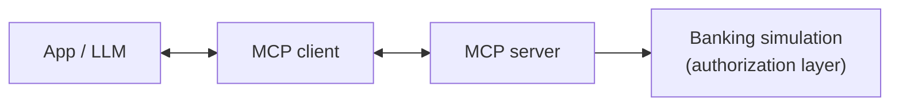
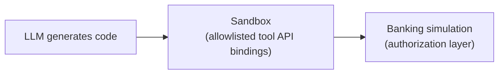

# Planned architecture (draft, not implemented)

These diagrams are conceptual and will be refined in the design phase. No MCP server, sandbox or banking simulation exists yet.

## A. MCP

## B. Code Mode

## Open design questions

- Which MCP SDK and transport?
- Which sandbox technology provides the required isolation?
- How are the two approaches kept equivalent in security assumptions?
- Which model, selected through configuration?
- How are tool definitions shared so both approaches expose the same capabilities?
