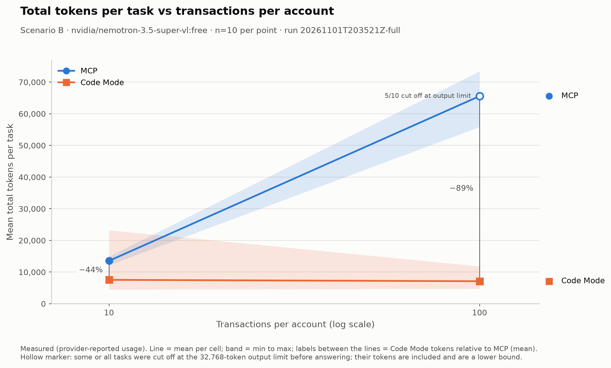
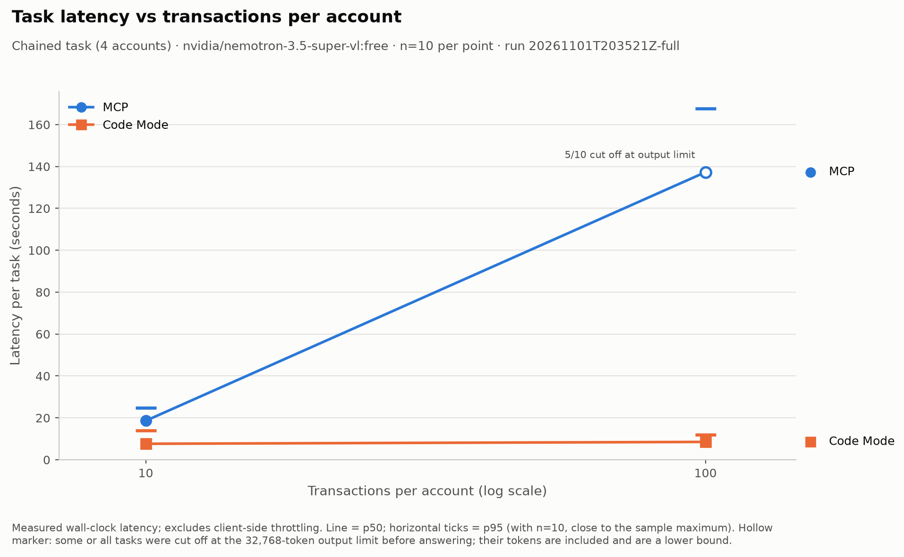
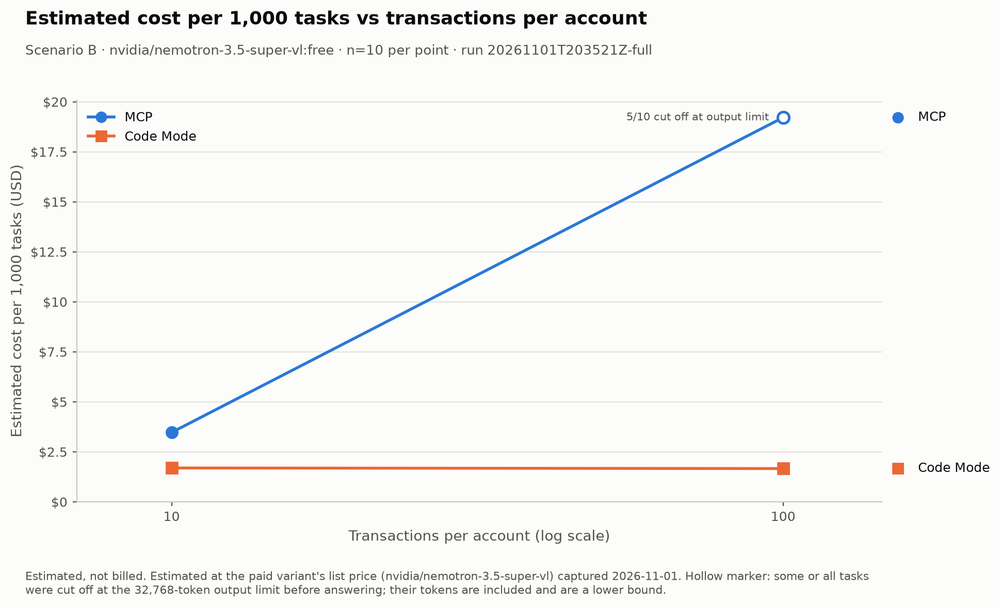
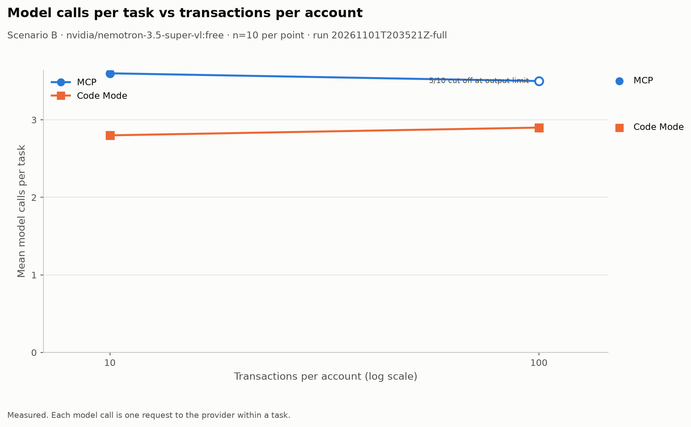
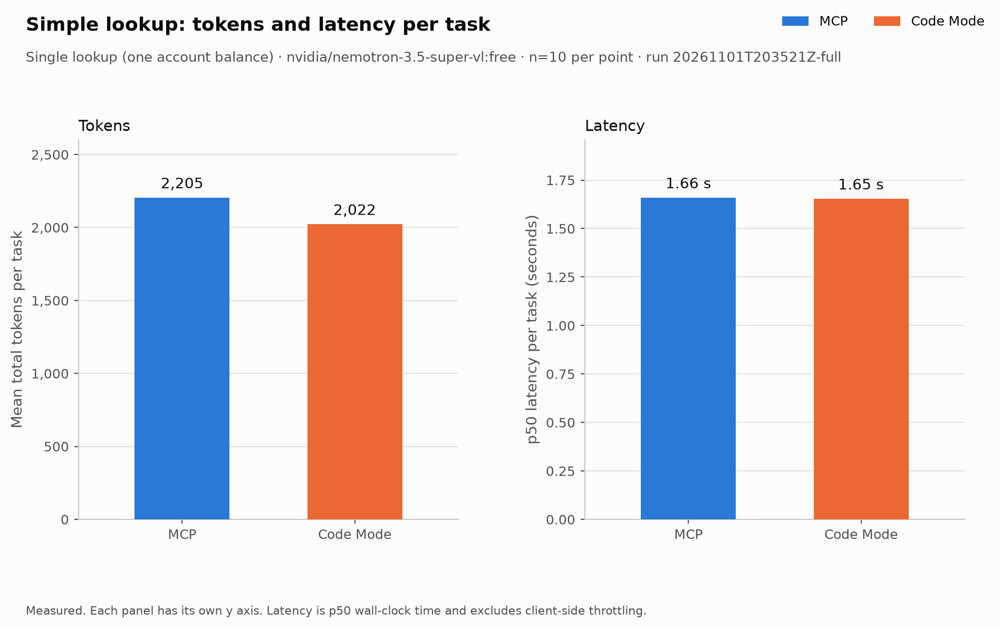
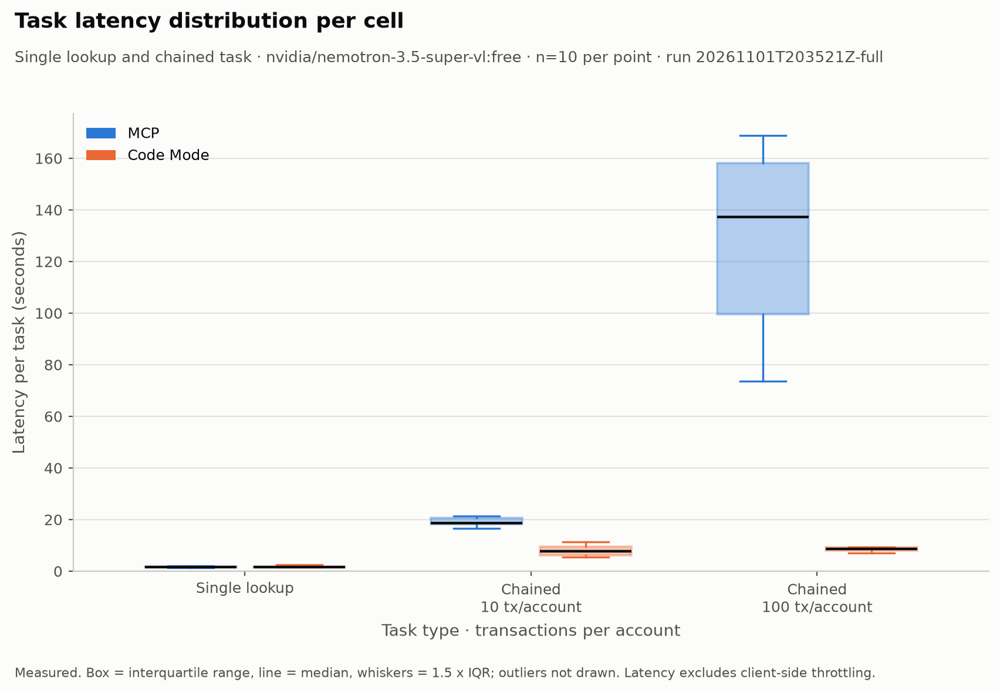
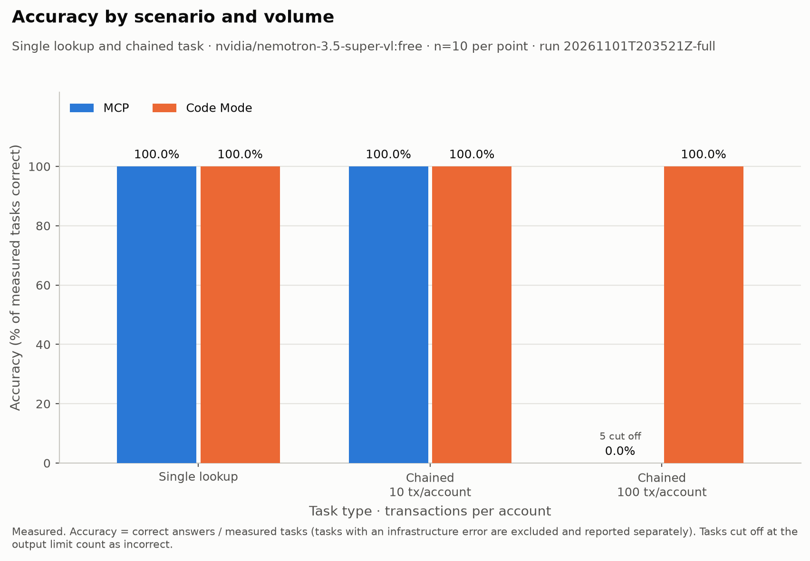
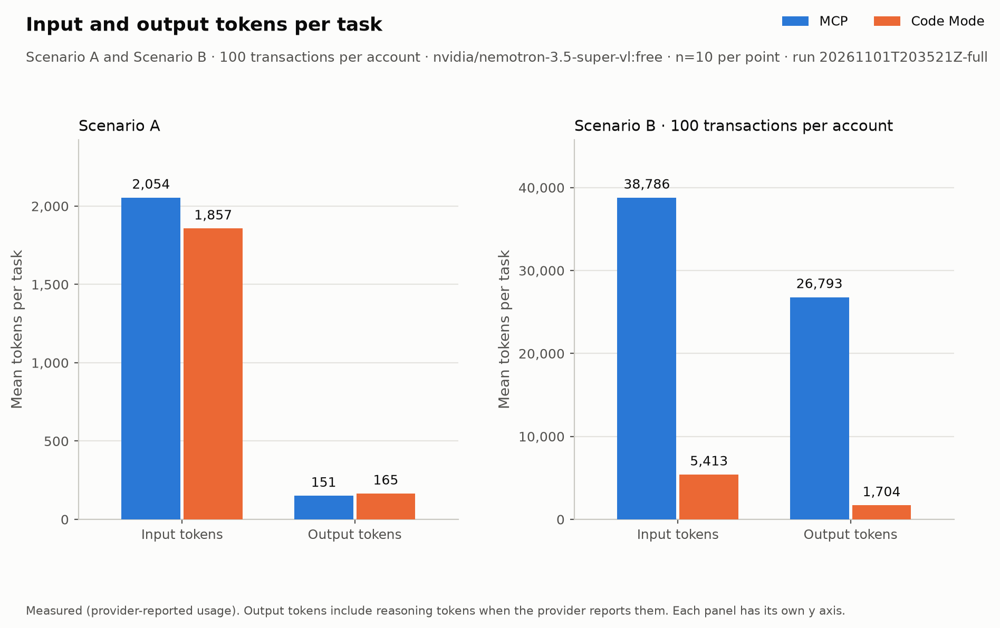

# Benchmark report — MCP vs Code Mode (20261101T203521Z-full)

## Executive summary

- **Scenario A** — tokens: Code Mode -8.3% vs MCP; p50 latency: Code Mode -0.4% vs MCP; accuracy: MCP 100.0%, Code Mode 100.0%
- **Scenario B, 10 transactions per account** — tokens: Code Mode -44.3% vs MCP; p50 latency: Code Mode -59.0% vs MCP; accuracy: MCP 100.0%, Code Mode 100.0%
- **Scenario B, 100 transactions per account** — tokens: Code Mode -89.1% vs MCP; p50 latency: Code Mode -93.8% vs MCP; accuracy: MCP 0.0%, Code Mode 100.0%
- **B100 · MCP**: 5 of 10 tasks were cut off at the 32,768-token output limit while reasoning; mean 65,579 tokens per task (lower bound). These tasks count as failures, not exclusions.

Percentages compare Code Mode with MCP; negative token change means fewer tokens.

> Author interpretation: see the [experiment README](../../../README.md), sections 13 (Analysis) and 15 (Conclusion).

## Research question

For an equivalent multi-step tool workflow, how do MCP-based tool calling and Code Mode differ in context overhead, token consumption, latency, reliability and security posture, and at what workflow shape and data volume does the difference become material?

## Experimental setup

- Scenario A: single balance lookup. Scenario B: chained aggregation at 10, 100 transactions per account.
- Cells: 6 (scenario x volume x mode).
- Iterations per cell: 10; warm-up tasks per mode: 1 (excluded from statistics).
- Maximum model turns per task: 8.
- Temperature: 0.0.
- Rate limit: 15 requests per minute; daily request cap 900.
- Tasks planned: 62; completed: 62.

## Environment

| Field | Value |
|---|---|
| Experiment | mcp-vs-code-mode 0.1.0 |
| Git commit | 3af3f6ae4b71f233c839c1dab5cfab13aa347813 |
| Started | 2026-11-01T20:35:21.578130+00:00 |
| Finished | 2026-11-01T21:08:55.696023+00:00 |
| Hardware | cpu_count 8, machine arm64, memory_gb 16.0, processor arm |
| Operating system | macOS-15.0.1-arm64-arm-64bit |
| Python | 3.12.12 |
| Provider | openrouter |
| Model id | nvidia/nemotron-3.5-super-vl:free |
| Dataset | 1.1.0 (checksum ad579f7026dd30417869520cc9b159715625e6eea05deabaf6e8faf9dab96d96) |
| Iterations per cell | 10 |
| Failed requests | 0 |
| Models served | nvidia/nemotron-3.5-super-vl:free |
| Providers served | Nvidia |
| Package versions | httpx 0.28.1, matplotlib 3.11.2, mcp 2.3.0, openai 3.42.0, pandas 3.1.0, pydantic-monty 1.4.0 |
| Pricing snapshot | paid_variant; priced as nvidia/nemotron-3.5-super-vl; prompt $0.15 / completion $0.5 per million tokens; captured 2026-11-01 |
| MCP connect time | 398 ms (once per run) |
| Sandbox warm-up time | 27 ms (once per run) |

## Methodology

Full methodology: [benchmarks/methodology.md](../../../benchmarks/methodology.md).

- Same model, temperature, turn limit, dataset and principal in both modes.
- Cells run interleaved in a seeded shuffled order each iteration.
- Ground truth is computed by plain Python; a task is correct only if every value matches.
- Token and latency statistics include all tasks with outcome other than `infra_error`; accuracy uses the same denominator.
- Percentiles use linear interpolation. Latency excludes client-side throttling.

## Results table

| Cell | n | completed | cut off | Accuracy | Mean tokens | p50 latency | p95 latency | Mean model calls | Cost per 1k tasks (est.) |
|---|---|---|---|---|---|---|---|---|---|
| A:mcp | 10 | 10 | 0 | 100.0% | 2,205 | 1.66 s | 1.94 s | 2.0 | $0.3834 |
| A:code | 10 | 10 | 0 | 100.0% | 2,022 | 1.65 s | 3.17 s | 2.0 | $0.3611 |
| B10:mcp | 10 | 10 | 0 | 100.0% | 13,555 | 18.62 s | 24.75 s | 3.6 | $3.471 |
| B10:code | 10 | 10 | 0 | 100.0% | 7,554 | 7.63 s | 14.04 s | 2.8 | $1.695 |
| B100:mcp | 10 | 5 | 5 | 0.0% | 65,579 | 137.29 s | 167.76 s | 3.5 | $19.21 |
| B100:code | 10 | 10 | 0 | 100.0% | 7,117 | 8.52 s | 12.03 s | 2.9 | $1.664 |

Cost is estimated, not billed. Estimated at the paid variant's list price (nvidia/nemotron-3.5-super-vl) captured 2026-11-01.

## Graphical comparisons

*Total tokens per task vs transactions per account.*

*Latency (p50, p95) vs transactions per account.*

*Estimated cost per 1,000 tasks vs transactions per account.*

*Model calls per task vs transactions per account.*

*Scenario A: tokens and latency.*

*Task latency distribution per cell.*

*Accuracy by scenario and volume.*

*Input and output tokens per task.*

## Key observations

| ID | Statement | Verdict | Evidence |
|---|---|---|---|
| H1 | Scenario A: mean total tokens and p50 latency differ by less than 25% between modes. | supported | A: tokens mcp 2,205 vs code 2,022 (-8.3%); p50 latency mcp 1.66 s vs code 1.65 s (-0.4%) |
| H2 | Scenario B: Code Mode uses fewer mean total tokens than MCP at every volume, and the gap widens with volume. | supported | B10: tokens mcp 13,555 vs code 7,554 (gap 6,001); B100: tokens mcp 65,579 vs code 7,117 (gap 58,462) |
| H3 | Scenario B: Code Mode has lower p50 latency than MCP at the largest measured volume (100). | supported | at volume 100: p50 latency mcp 137.29 s vs code 8.52 s (-93.8%) |
| H4 | MCP accuracy at the largest measured volume (100) is lower than at the smallest (10); Code Mode accuracy max - min across measured volumes (10, 100) is at most 10 percentage points. | supported | MCP accuracy B10 100.0% vs B100 0.0%; Code Mode accuracy spread across volumes 0.0 percentage points |

> Author interpretation: see the [experiment README](../../../README.md), section 13 (Analysis).

## Engineering trade-offs

> Author section: see the [experiment README](../../../README.md), sections 13 and 15.

## Limitations

- Single model.
- Free-tier provider routing adds latency variance.
- stdio MCP transport only (no network hop).
- Monty runs a Python subset.
- Synthetic data.
- Cost is estimated, not billed.
- n=10 per cell makes p95 close to the sample maximum.
- Infrastructure errors (latest record per task): 0; infrastructure-error records over the whole run: 0. These tasks are excluded from token, latency and accuracy statistics.
- Failed or retried provider requests: 0.
- Records superseded by a later attempt: 0; warm-up tasks excluded: 2.
- Providers served: 1 (Nvidia).
- Output-limit rule: a task whose final model call is cut off at the 32,768-token output limit (`finish_reason` = length) before giving an answer is scored as a failure and stays in every statistic; it is not excluded. Its tokens are included and are a lower bound on what the model would have used. `completed` = measured tasks that produced a final answer (right or wrong); `cut off` = measured tasks that did not. See [methodology section 3](../../../benchmarks/methodology.md#3-controls).
- Measured volumes: 10, 100 (dataset also contains 50, 200; see [methodology section 3](../../../benchmarks/methodology.md#3-controls) for the scope decision and canary observations).
- The run was not halted.

## Conclusion

> Author section: see the [experiment README](../../../README.md), sections 13 and 15.
