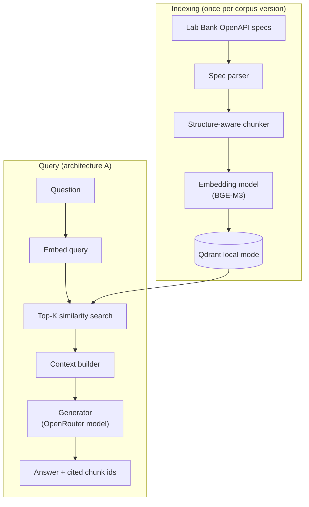

# 02 — RAG Architecture Comparison

> **Status:** Stage 2 in progress (generation pipeline verified offline; real run pending)
> **Experiment version:** 0.1.0
> **Last updated:** 2026-11-11

## 1. Overview

This experiment builds an API knowledge assistant that answers questions about a set of synthetic OpenAPI 3.1 specifications for a fictional bank, "Lab Bank". Four retrieval architectures are built one at a time against the same corpus and the same questions. Retrieval quality and answer quality are measured separately, so a wrong answer can be traced to either the retriever or the generator.

Terminology used throughout (see [docs/rag-fundamentals.md](docs/rag-fundamentals.md) for the full explanation):

- **Chunk:** a small piece of a spec (for example, the parameters of one operation) that is embedded and retrieved on its own.
- **Retrieval:** finding the chunks most relevant to a question.
- **Generation:** asking the language model to answer using only the retrieved chunks.
- **Architecture A, B, C, D:** the four retrieval strategies compared (section 8).

## 2. Research Question

How do different retrieval strategies and agentic orchestration approaches affect the accuracy, relevance, latency and cost of Retrieval-Augmented Generation over API specifications, and when is the added complexity justified?

## 3. Why This Matters

- API documentation mixes prose with exact identifiers: paths, header names, error codes and field names.
- Dense (embedding) retrieval is good at meaning and can be weak at exact strings. A developer asking about `RATE-001` wants that code, not something that merely sounds similar.
- Teams often add hybrid search, rerankers and agents by default. Each adds components, latency and cost. This experiment measures what each one actually buys on one concrete task.

## 4. Hypotheses

Architecture A hypotheses were **frozen on 2026-11-11**, before any retrieval or answer was measured. Exact definitions are in [docs/evaluation-methodology.md](docs/evaluation-methodology.md) section 8. All are evaluated on the frozen measured question set (Q101–Q140) and are *unverified*.

- **HA1** (*unverified*): baseline dense retrieval reaches Hit@5 of at least 0.80 on the `semantic` and `endpoint_discovery` questions combined.
- **HA2** (*unverified*): baseline Hit@5 on `exact_identifier` questions is at least 20 points lower than on `semantic` and `endpoint_discovery` combined.
- **HA3** (*unverified*): when a relevant chunk is in the generation context (top 5), answer correctness is at least 0.80; when none is, correctness is at most 0.20.
- **HA4** (*unverified*): the correct-refusal rate on unanswerable questions is at least 0.80.
- **HB, HC, HD** (*unverified*): placeholders for the hybrid, rerank and agentic milestones, defined in the methodology document.

## 5. Objectives

1. Understand each RAG building block: embeddings, vector search, chunking, context construction, reranking and agentic retrieval.
2. Build a reproducible baseline and evaluate it before adding anything.
3. Measure what each additional component changes, one component at a time.
4. Separate retrieval metrics from answer metrics and from guardrail metrics (abstention).
5. Report latency and cost per stage, labelling estimates as estimates.
6. Decide, with evidence, when each architecture is worth its complexity.

## 6. Scope

### In scope

- The four architectures (A to D).
- Synthetic specifications written for this experiment.
- English only.
- A single generation model, selected through configuration.
- Local embedding and reranking models.

### Out of scope

- Production serving.
- A Qdrant server or cloud deployment.
- Fine-tuning.
- Multilingual retrieval.
- A user interface.
- Real or confidential specifications.
- LLM-as-judge scoring as the primary metric.

## 7. Architecture

The pipeline has two paths. Indexing parses the specs into chunks, embeds them and stores them in a local vector store. Querying embeds the question, retrieves the nearest chunks, builds a prompt and asks the model to answer with citations. Retrieval and generation are separately callable, so retrieval can be evaluated without any model request. The full design is in [docs/architecture.md](docs/architecture.md).



### Generation

The generator sends the retrieved chunks to the model as numbered `<excerpt id="...">` blocks and asks for one JSON object: `{"answer": ..., "cited_chunk_ids": [...], "insufficient_context": true|false}`. The prompt (version `a-1.0`, recorded with a hash in every run) tells the model to use only the excerpts, to treat them as data rather than instructions, and to set `insufficient_context` instead of guessing. A reply that is not valid JSON in that shape is recorded as an invalid answer (or a cut-off, when the model ran out of output tokens); it is never repaired beyond stripping a code fence or surrounding prose. Refusal is read from the structured flag, not from the wording of the answer. Answer correctness, groundedness and citation checks are deterministic; see the operational definitions in [docs/evaluation-methodology.md](docs/evaluation-methodology.md).

## 8. Implementation Approaches

Each architecture adds one piece to the previous one.

| Architecture | Adds | Status |
|---|---|---|
| A. Baseline | Dense vector retrieval over structure-aware chunks | Planned for Stage 2 |
| B. Hybrid | BM25 keyword search combined with dense search by Reciprocal Rank Fusion | Later milestone |
| C. Hybrid + rerank | A cross-encoder that re-scores the fused candidates | Later milestone |
| D. Agentic | A LangGraph agent that plans, searches, checks the evidence and searches again | Later milestone |

These are composable capabilities, not exclusive categories: architecture D can use C's retriever as its tool.

## 9. Technology Stack

| Component | Choice | Why | Needed in |
|---|---|---|---|
| Embeddings | `BAAI/bge-m3` via sentence-transformers and PyTorch | Strong open model, 1,024-dimension dense vectors, runs locally | A |
| Vector store | Qdrant local mode (`qdrant-client`) | In-process, no server, persists to a folder | A |
| Generation | OpenRouter through the `openai` SDK; model set by `LLM_MODEL` | Same access path as experiment 01; never hardcoded | A |
| Keyword search | Hand-written BM25 (about 40 lines) | Small enough to read end to end | B |
| Reranker | `BAAI/bge-reranker-v2-m3` cross-encoder | Same runtime as the embedding model | C |
| Agent orchestration | LangGraph | Only when the agentic milestone needs it | D |

Size implications (the model card figures are listed first; the measured installation and weights sizes are in [architecture.md](docs/architecture.md) section 6):

- BGE-M3 has about 568M parameters and about 2.3 GB of weights at fp32. Expect a few GB of memory while embedding.
- Weights download to the Hugging Face cache and are never committed.
- CPU is the default for reproducibility. Apple GPU (MPS) is optional through configuration.
- PyTorch is a large dependency, introduced with the embedding model in Stage 2.

## 10. Experimental Methodology

Every architecture runs the same corpus, the same questions, the same generation model, temperature 0, the same prompt version and the same top-K. Retrieval is evaluated first, with no model requests. Generation is repeated three times per question to see variance. Hypotheses are written down before each architecture's measured run.

Full details: [docs/evaluation-methodology.md](docs/evaluation-methodology.md). Dataset design: [docs/dataset-design.md](docs/dataset-design.md).

## 11. Evaluation Metrics

| Group | Metrics | Measured or estimated |
|---|---|---|
| Retrieval | Hit@K, Recall@K, Precision@K, MRR for K in 1, 3, 5, 10 | Measured, no model requests |
| Answer | Correctness against key facts, groundedness (unsupported and invented identifiers), citation validity, answer relevance (manual) | Measured |
| Guardrail | Correct-refusal rate and made-up-answer rate on unanswerable questions | Measured |
| Performance | Latency per stage (p50, p95), tokens, success and failure rates | Measured |
| Cost | Cost per question | **Estimated** |
| Indexing | Chunk count, embedding time | Measured, reported separately |

Definitions and caveats are in [docs/evaluation-methodology.md](docs/evaluation-methodology.md). See also the [benchmarking standards](../../docs/standards/benchmarking-standards.md).

## 12. Results

> Results pending. Do not fill in until benchmarks have been run.

## 13. Analysis

> Results pending. Do not fill in until benchmarks have been run.

## 14. Limitations

- Small, synthetic, self-authored corpus and question set.
- A single generation model.
- Qdrant local-mode latency does not represent a Qdrant server.
- Free-model routing variance on OpenRouter.
- Deterministic groundedness covers identifiers only, not prose claims.
- BGE-M3 is larger than an English corpus of this size needs.
- The sample size is small, so results are reported per question rather than as statistically significant differences.

## 15. Conclusion

> Results pending. Do not fill in until benchmarks have been run.

## Milestones

1. Stage 1: design documentation (this stage).
2. Stage 2: baseline A (parser, chunker, embeddings, Qdrant, generator, CLI), then measured evaluation of A.
3. Architecture B (hybrid), then evaluation.
4. Architecture C (rerank), then evaluation.
5. Architecture D (agentic), then evaluation.
6. Comparison report and LinkedIn content.

Each architecture stops for review before the next begins.

## 16. How to Run

Corpus, question sets, chunking, embeddings, the local Qdrant index, dense retrieval and the generation pipeline exist. The generation pipeline has been exercised only with a deterministic fake model (a simulated oracle); no real model has answered a question yet, and no answer results exist. Everything below runs without an API key unless noted.

```bash
make install
uv run rag-experiment chunks
uv run rag-experiment show-chunk accounts-api:getAccountBalances:operation
uv run rag-experiment validate-dataset
uv run rag-experiment index                       # first run downloads BAAI/bge-m3 (about 2.3 GB)
uv run rag-experiment retrieve --question-id Q01 -k 5
uv run rag-experiment evaluate-retrieval --set dev
uv run rag-experiment evaluate-retrieval --set measured
uv run rag-experiment preflight                   # offline checks, no request
uv run rag-experiment canary --fake               # simulated canary (3 questions)
uv run rag-experiment run --set dev --fake        # simulated dev run (15 x 3)
uv run rag-experiment analyse RUN_ID              # rebuild summary, report and charts
make test-models                                  # tests that load the real embedding model
```

- `chunks` lists every chunk with its type, size and source (`--document`, `--type`, `--full` narrow or expand it).
- `show-chunk` prints one chunk with its metadata.
- `validate-dataset` loads the corpus, chunks it and validates both question files; it exits with 1 if it finds a problem.
- `index` embeds the chunks and builds the local Qdrant index under `.index/` (gitignored). It is idempotent (`--rebuild` forces a rebuild).
- `retrieve` prints the top chunks for a question; `--question-id` takes the text from a question set and marks the relevant chunks, `--show` prints the top chunk.
- `evaluate-retrieval` retrieves every question of a set twice (determinism check) and writes the run under `results/raw`, `results/processed` and `results/reports`.
- `--fake-embeddings` on these commands uses a deterministic stand-in embedder for a dry run; its output goes to `results/dry-run/` and is not a measurement.
- `preflight` checks the configuration, the prompt version, that `LLM_MODEL` and `OPENROUTER_API_KEY` are set (it prints "set", never the value), that the local index is complete, that the question sets are valid and the measured set matches its frozen checksum, the largest prompt, and the planned request count against the daily cap. `preflight --live` also looks the model up, resolves a price, reads the key's free-model counters and sends one tiny completion (it prints "live checks will send 1 model request" first).
- `canary` runs the canary questions of the development set once; `run --set dev|measured` generates and scores every question three times, appending one record per attempt to `results/raw/<run id>/answers.jsonl`. `run --resume RUN_ID` continues an interrupted run, skipping attempts that already have a result. A run stops cleanly when the provider's daily limit or the configured request cap is reached.
- `analyse RUN_ID` rebuilds the summary, the report and the charts from the raw files without any request.
- `--fake` on `canary` and `run` uses a deterministic fake chat model and a placeholder price: no key is needed, the network is never touched, files go to `results/dry-run/`, and every report and chart is labelled SIMULATED.
- Only one process can open the local index at a time. The default test run never downloads a model.

## 17. References

- Lewis et al., 2020, "Retrieval-Augmented Generation for Knowledge-Intensive NLP Tasks", arXiv:2005.11401.
- Chen et al., 2024, "BGE M3-Embedding", arXiv:2402.03216. Model card: <https://huggingface.co/BAAI/bge-m3>.
- Robertson and Zaragoza, 2009, "The Probabilistic Relevance Framework: BM25 and Beyond".
- Cormack, Clarke and Büttcher, 2009, "Reciprocal Rank Fusion outperforms Condorcet and individual rank learning methods", SIGIR.
- Nogueira and Cho, 2019, "Passage Re-ranking with BERT", arXiv:1901.04085.
- Qdrant documentation: <https://qdrant.tech/documentation/>. Python client and local mode: <https://github.com/qdrant/qdrant-client>.
- Sentence Transformers documentation: <https://sbert.net>.
- OpenAPI Specification 3.1.0: <https://spec.openapis.org/oas/v3.1.0>.
- RFC 6901, JavaScript Object Notation (JSON) Pointer.
- LangGraph documentation (milestone D): <https://langchain-ai.github.io/langgraph/>.
