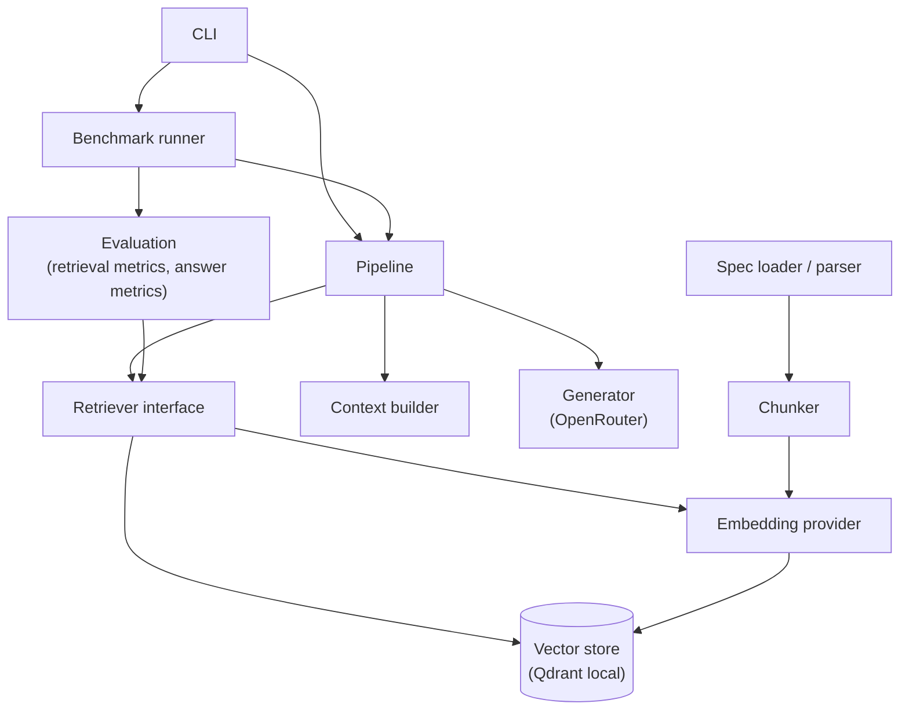
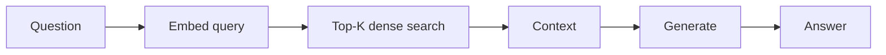
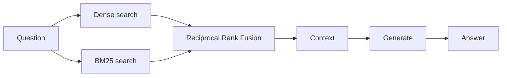
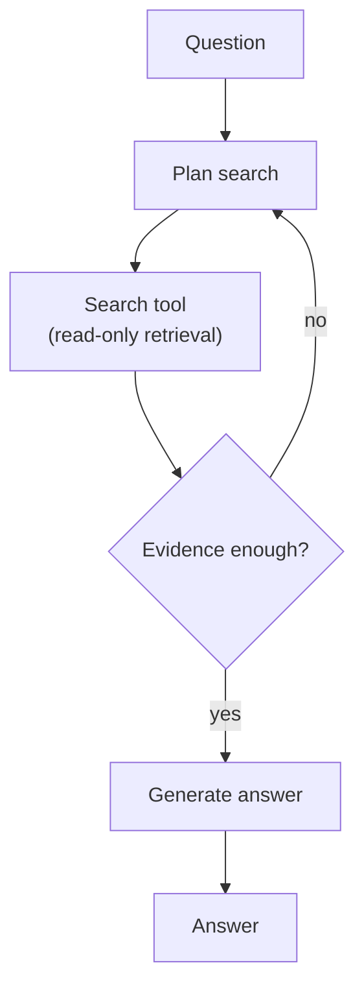

# Architecture

Design for the RAG architecture comparison. Status: Stage 1 (design only). Nothing described here is implemented yet.

## 1. Goals and non-goals

**Goals**

- A small, readable pipeline whose every stage can be inspected.
- Retrieval that can be evaluated without any model request.
- The same interfaces across architectures, so each milestone changes one thing.
- Reproducible runs: pinned data versions, recorded configuration, deterministic ingestion.

**Non-goals**

- Production serving, authentication or scaling.
- A general RAG framework. Shared code moves into `ai_lab` only when it is actually reused.
- Real or confidential documents.

## 2. Components and boundaries



| Component | Why it exists |
|---|---|
| Spec loader / parser | Reads the YAML specs and exposes operations, parameters, responses and components with their JSON Pointers. |
| Chunker | Turns parsed specs into the normalised chunk model ([dataset-design.md](dataset-design.md) section 2). Deterministic. |
| Embedding provider | Hides the embedding model behind two methods, so the model can be swapped and cached. |
| Vector store (Qdrant local) | Stores chunk vectors and payloads and answers nearest-neighbour queries. |
| Retriever interface | One method, `retrieve(query, k)`. Architectures A, B and C implement it. |
| Context builder | Formats retrieved chunks into the prompt, with ids and headers for citation. |
| Generator (OpenRouter) | Calls the language model and validates its structured response. |
| Pipeline | Wires retriever, context builder and generator for one question. |
| Evaluation | Computes retrieval metrics and answer metrics from results and the question set. |
| Benchmark runner | Runs the question set, records raw results and run metadata, enforces the request budget. |
| CLI | The entry point for ingest, retrieve, ask and evaluate commands. |

**Key rule:** retrieval and generation are separately callable. Retrieval can be evaluated against the question set with zero model requests, which makes it fast, free and repeatable.

## 3. Proposed module layout

Proposed; finalised in the Stage 2 plan.

```text
src/rag_experiment/
├── config.py
├── ingestion/
│   ├── parser.py
│   └── chunker.py
├── embeddings/
│   └── provider.py
├── retrieval/
│   ├── base.py
│   ├── vector.py
│   │   (later: bm25.py, hybrid.py, rerank.py)
├── generation/
│   ├── provider.py
│   └── prompts.py
├── evaluation/
│   ├── dataset.py
│   ├── retrieval_metrics.py
│   └── answer_metrics.py
├── pipeline.py
└── cli.py
tests/
├── unit/
└── integration/
```

Shared reuse: the OpenRouter client, the request budget and limiter, and the run-metadata helper from experiment 01 are copied into the shared `ai_lab` package in Stage 2. They are copied, not moved, so experiment 01 stays unchanged and reproducible.

## 4. Interfaces

Described here in prose and pseudo-signatures. They are not code files.

### Retriever

```text
Retriever.retrieve(query: str, k: int) -> list[RetrievedChunk]
RetrievedChunk = chunk + score + rank + retriever name
```

Architectures A, B and C implement the same interface. Architecture D uses retrievers as tools rather than implementing the interface itself.

### EmbeddingProvider

```text
EmbeddingProvider.embed_documents(texts: list[str]) -> list[vector]
EmbeddingProvider.embed_query(text: str) -> vector
```

- Documents are embedded in batches.
- Vectors are normalised, so cosine similarity equals the dot product.
- BGE-M3 needs no query instruction prefix, unlike the BGE v1.5 models. This is from the model card.
- A cache keyed by (model id, model revision, chunk content hash) avoids re-embedding unchanged chunks.

### Generator

```text
Generator.generate(question: str, chunks: list[RetrievedChunk]) -> GeneratedAnswer
GeneratedAnswer = {answer, cited_chunk_ids, insufficient_context, usage, latency}
```

The model is asked for one JSON object with exactly these fields:

```json
{"answer": "<text>", "cited_chunk_ids": ["<excerpt id>", "..."], "insufficient_context": false}
```

Each retrieved chunk is placed in the prompt as an `<excerpt id="{chunk_id}">` block in rank order, so the model can cite by id. Parse rules:

1. Whitespace and one surrounding code fence are stripped.
2. The whole text is tried as JSON; if that fails, the first balanced `{...}` (counting braces outside JSON strings) is tried.
3. `answer` must be a string, `cited_chunk_ids` a list of strings (empty if missing) and `insufficient_context` a boolean (required).
4. Anything else is a recorded parse failure with a short reason. No other repair is attempted.

A malformed response is a recorded failure (`invalid_answer`, or `cut_off` when the output was truncated), never an exception and never silently repaired. Provider failures after retries are a separate, recorded `infra_error`.

## 5. Qdrant local-mode design

- One collection per (corpus version, chunking config, embedding model). Changing any of the three creates a new collection rather than mixing vectors.
- Point id is a deterministic UUID5 of `chunk_id`. Re-ingesting the same chunk overwrites the same point, so ingestion is idempotent.
- Payload is the chunk metadata.
- Distance is cosine.
- Rebuild means drop and recreate the collection.

**Caveat:** local mode (`QdrantClient(path=...)`) is an in-process, exact-search implementation intended for development and small collections (qdrant-client documentation). Its latency does not represent a Qdrant server. Retrieval latency is therefore reported as "local mode".

## 6. Technology assessment

Target machine: Apple M1, 16 GB RAM.

| Technology | Why | Alternatives considered | Size and hardware | Milestone |
|---|---|---|---|---|
| sentence-transformers + PyTorch | Standard way to run BGE-M3 locally and the same runtime for the reranker | Ollama (see below); ONNX runtimes | Large dependency. Measured: `.venv` grew from 336 MB to 1.3 GB (`du -sh .venv`, macOS arm64) after adding sentence-transformers, torch, qdrant-client and numpy. | A |
| BGE-M3 (`BAAI/bge-m3`) | Strong open embedding model with 1,024-dimension dense vectors | `bge-small-en-v1.5`; hosted embedding APIs | About 568M parameters, about 2.3 GB of weights at fp32 (model card). Measured: the pinned revision's `pytorch_model.bin` is 2.27 GB in the Hugging Face cache; the library also fetched an auto-converted `model.safetensors` of 2.27 GB from a separate Hub revision, so the cache holds 4.56 GB of unique files. All 391 tensors in the two files were compared and are bit-identical; the config now sets `use_safetensors: false` so only the pinned revision's file is loaded. Memory use while embedding is still to be measured. | A |
| Qdrant local mode | In-process, no server, persists to a folder, same client API as a Qdrant server | Chroma; FAISS; pgvector | Small for a few hundred chunks. | A |
| OpenRouter via the `openai` SDK | Same access path as experiment 01; model chosen by `LLM_MODEL` | Direct provider SDKs | No local resources. | A |
| BM25, hand-written | About 40 lines; easy to read and test | `rank_bm25` library | Negligible. | B |
| `BAAI/bge-reranker-v2-m3` cross-encoder | Same runtime as the embedding model | Hosted rerank APIs | Weights size and latency to be measured at milestone C. | C |
| LangGraph | Explicit graph for the plan, search, check loop | A hand-written loop, as in experiment 01 | Pure Python dependency. | D only |

Notes:

- The BGE-M3 weights download to the Hugging Face cache and are never committed.
- CPU is the default for reproducibility. MPS (Apple GPU) is optional through configuration, and results from the two devices are not mixed.
- Alternative considered: Ollama serving `bge-m3`. It avoids PyTorch in the environment, but adds a separate service and offers no reranker, so milestone C would need a second runtime.
- Alternative considered: `bge-small-en-v1.5`, which is much smaller. It is kept as a fallback only with maintainer approval, because changing the embedding model changes the experiment.

## 7. The four architectures

These are composable capabilities, not exclusive categories. Architecture D can use C's retriever as its search tool.

### A. Baseline (dense)



- **How it works:** embed the question, take the K nearest chunks by cosine similarity, build the prompt, generate.
- **Advantages:** simplest design; one retrieval call; cheap; a clear baseline.
- **Limitations:** weak on exact identifiers that carry little meaning, such as `RATE-001`; near-duplicate chunks can crowd the top K.
- **Latency and compute:** one query embedding, one vector search, one model call. Figures to be measured in Stage 2.
- **Use cases:** meaning-based questions where the user does not know the spec's vocabulary.

### B. Hybrid (BM25 + dense + RRF)



- **How it works:** run both searches, merge their ranked lists with RRF (k = 60), take the top K.
- **Advantages:** keyword search recovers exact identifiers; dense search keeps meaning-based matches; rank fusion needs no score calibration.
- **Limitations:** two indexes to maintain; BM25 tokenisation of identifiers such as `X-Api-Key` needs care; RRF ignores score magnitude.
- **Latency and compute:** one extra, cheap keyword search. Figures to be measured.
- **Use cases:** documentation where users paste exact names and also ask in their own words.

### C. Hybrid + cross-encoder rerank


- **How it works:** retrieve a larger candidate set (N greater than K), score each (query, chunk) pair with the cross-encoder, keep the best K.
- **Advantages:** reads query and chunk together, so it can separate look-alike chunks that the first stage ranks closely.
- **Limitations:** extra model to host; latency grows with N; cannot recover a chunk that stage one did not retrieve.
- **Latency and compute:** N cross-encoder passes per query. To be measured at this milestone.
- **Use cases:** collections with many near-duplicates, where ordering at the top matters.

### D. Agentic (LangGraph)



- **How it works:** a graph with plan, search and judge nodes. The agent may search several times, with different queries, before answering. A step limit bounds the loop.
- **Advantages:** can answer multi-step questions that one search cannot cover; can refine a poor first query.
- **Limitations:** several model calls per question; harder to make deterministic; more ways to fail.
- **Latency and compute:** model calls per question grow with the number of searches. To be measured.
- **Use cases:** questions that span several endpoints or need comparison.

## 8. Security and data handling

- Synthetic data only. No real specification, credential or customer data enters the repository.
- The OpenRouter API key is read from the environment through the shared `Settings` class and is never logged or written to results.
- Retrieved content is untrusted input to the model. The prompt marks it as data, not instructions.
- Architecture D's tools are read-only retrieval. There is no code execution and no network access beyond the model call.

## 9. Proposed implementation plan

**Stage 2 (architecture A)**

1. Write the five synthetic specs and finalise the question set: the 15-question development set, then the expanded measured set (30–50), frozen and versioned before any measured run.
2. Spec parser and chunker, with unit tests.
3. Embedding provider and Qdrant store, with tests.
4. Retrieval evaluation against the question set (no model requests).
5. Generator with a fake provider for tests, and the prompt.
6. CLI.
7. Preflight and a two-question canary against the real model.
8. Measured run and report.

Exit criteria: tests and `make check` pass, retrieval evaluation reproducible, one measured run with complete metadata, report written. Then stop for review.

**Milestones B, C and D**

Each adds one component, reruns the same evaluation on the same questions, writes down its hypothesis before the measured run, and then stops for review.
