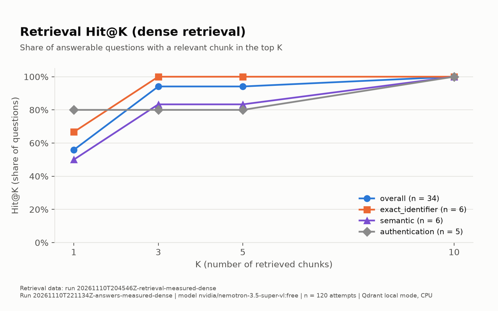
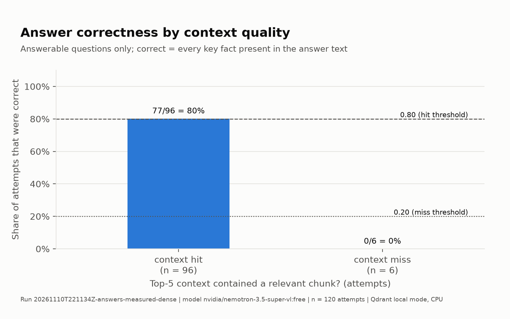
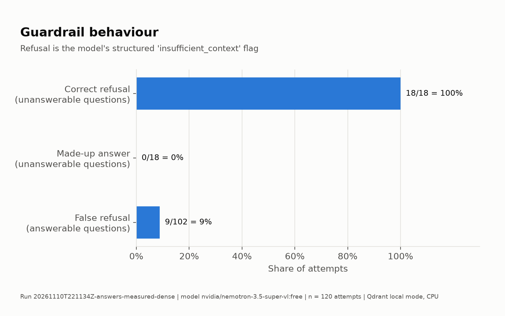
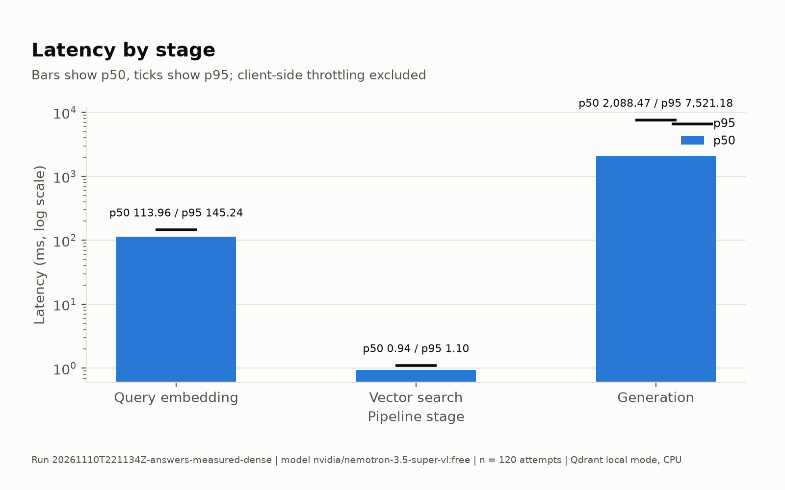
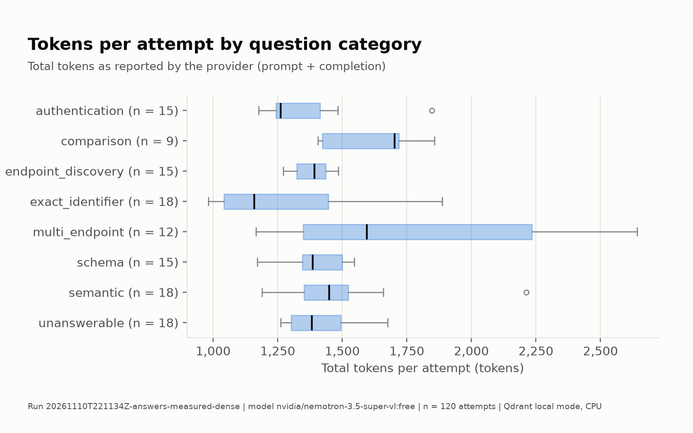

# Answer report: 20261110T221134Z-answers-measured-dense

## Setup

- Corpus: version 1.0.0, checksum `72063d1be60b13a9e9a5105f04b081a161fa010cb11d210d0be3589b8726c0e6`
- Question set: measured, version 1.0.0, checksum `28d846ec119f105cbb6d6b36b5b00bda0dd7b7a1b16d4b43179c359f5432cede`
- Generation model: `nvidia/nemotron-3.5-super-vl:free` via openrouter; served by models ['nvidia/nemotron-3.5-super-vl:free'], providers ['Nvidia']
- Prompt: version a-1.0, hash `bc694d3da6e02137e4df755079dc355e99a1cf29506953c90c17631ac919abfc`
- Generation settings: {'prompt_version': 'a-1.0', 'temperature': 0.0, 'max_output_tokens': 16384, 'llm_seed': None, 'request_timeout_seconds': 300}
- Run settings: {'repetitions': 3, 'order_seed': 20261111, 'rate_limit_per_minute': 15, 'daily_request_cap': 900, 'canary_question_ids': ['Q01', 'Q05', 'Q14']}
- Retrieval: dense, context = top 5 chunks; embedding `BAAI/bge-m3` revision `5617a9f61b028005a4858fdac845db406aefb181` (cpu); collection `lab-bank-c1-0-0-72063d1b-bge-m3-5617a9f6-m2400`; retrieval deterministic: True
- Run timing: started 2026-11-10 22:11:34 UTC, finished 2026-11-10 22:20:24 UTC
- Git: `d540ce84ce457cc469cbabdc7c822e7df5d6d061` (dirty: True); Python 3.12.12; macOS-15.0.1-arm64-arm-64bit
- Attempts: 120 planned, 120 completed, 0 unresolved infrastructure errors; halted: False

## Results

Infrastructure errors are excluded from every quality denominator below.

| group | n | answered | refused | invalid | cut off | correctness (answerable) | false refusal (answerable) | correct refusal (unanswerable) |
|---|---|---|---|---|---|---|---|---|
| overall | 120 | 93 | 27 | 0 | 0 | 77/102 = 0.755 | 9/102 = 0.088 | 18/18 = 1.000 |
| authentication | 15 | 12 | 3 | 0 | 0 | 9/15 = 0.600 | 3/15 = 0.200 | n/a (0) |
| comparison | 9 | 9 | 0 | 0 | 0 | 6/9 = 0.667 | 0/9 = 0.000 | n/a (0) |
| endpoint_discovery | 15 | 15 | 0 | 0 | 0 | 15/15 = 1.000 | 0/15 = 0.000 | n/a (0) |
| exact_identifier | 18 | 18 | 0 | 0 | 0 | 15/18 = 0.833 | 0/18 = 0.000 | n/a (0) |
| multi_endpoint | 12 | 9 | 3 | 0 | 0 | 6/12 = 0.500 | 3/12 = 0.250 | n/a (0) |
| schema | 15 | 15 | 0 | 0 | 0 | 12/15 = 0.800 | 0/15 = 0.000 | n/a (0) |
| semantic | 18 | 15 | 3 | 0 | 0 | 14/18 = 0.778 | 3/18 = 0.167 | n/a (0) |
| unanswerable | 18 | 0 | 18 | 0 | 0 | n/a (0) | n/a (0) | 18/18 = 1.000 |

## Hypotheses (frozen criteria, computed mechanically)

| hypothesis | criterion | verdict | evidence |
|---|---|---|---|
| HA3 | correctness >= 0.80 when the top-5 context has a relevant chunk and <= 0.20 when it has none; the 'none' half needs at least 3 attempts | supported | context hit 77/96 correct = 0.802; context miss 0/6 correct = 0.000 |
| HA4 | correct-refusal rate over unanswerable attempts >= 0.80 | supported | correct refusals 18/18 = 1.000 |

## Guardrails

| measure | value |
|---|---|
| correct refusal (unanswerable) | 18/18 = 1.000 |
| made-up answer (unanswerable) | 0/18 = 0.000 |
| invalid answers on unanswerable attempts | 0 |
| cut-off answers on unanswerable attempts | 0 |
| false refusal (answerable) | 9/102 = 0.088 |
| diagnostic: unanswerable answers naming an endpoint (not scored) | 3 |

## Groundedness and citations

Identifiers only (endpoints, paths, error codes, scopes, headers, names); identifiers repeated from the question are not counted.

| measure | value |
|---|---|
| answers with at least one unsupported identifier | 1/120 = 0.008 |
| answers with at least one invented identifier | 0/120 = 0.000 |
| all cited ids were in the context (answered, must cite) | 93/93 = 1.000 |
| at least one cited id is relevant (answered, must cite) | 93/93 = 1.000 |

Most frequent unsupported identifiers: `header:location` x1

Most frequent invented identifiers: none

## Per question

| id | category | context hit | correct | outcomes | agree | missing key facts |
|---|---|---|---|---|---|---|
| Q101 | semantic | yes | 2/3 | answered, answered, answered | no | `VAL-001` |
| Q102 | semantic | yes | 3/3 | answered, answered, answered | yes | - |
| Q103 | exact_identifier | yes | 3/3 | answered, answered, answered | yes | - |
| Q104 | semantic | no | 0/3 | refused, refused, refused | yes | `/v1/statement-requests/{requestId}`, `Location` |
| Q105 | schema | yes | 3/3 | answered, answered, answered | yes | - |
| Q106 | schema | yes | 0/3 | answered, answered, answered | yes | `pageSize` |
| Q107 | exact_identifier | yes | 3/3 | answered, answered, answered | yes | - |
| Q108 | semantic | yes | 3/3 | answered, answered, answered | yes | - |
| Q109 | exact_identifier | yes | 3/3 | answered, answered, answered | yes | - |
| Q110 | semantic | yes | 3/3 | answered, answered, answered | yes | - |
| Q111 | schema | yes | 3/3 | answered, answered, answered | yes | - |
| Q112 | semantic | yes | 3/3 | answered, answered, answered | yes | - |
| Q113 | schema | yes | 3/3 | answered, answered, answered | yes | - |
| Q114 | schema | yes | 3/3 | answered, answered, answered | yes | - |
| Q115 | exact_identifier | yes | 0/3 | answered, answered, answered | yes | `404` |
| Q116 | exact_identifier | yes | 3/3 | answered, answered, answered | yes | - |
| Q117 | exact_identifier | yes | 3/3 | answered, answered, answered | yes | - |
| Q118 | endpoint_discovery | yes | 3/3 | answered, answered, answered | yes | - |
| Q119 | endpoint_discovery | yes | 3/3 | answered, answered, answered | yes | - |
| Q120 | endpoint_discovery | yes | 3/3 | answered, answered, answered | yes | - |
| Q121 | endpoint_discovery | yes | 3/3 | answered, answered, answered | yes | - |
| Q122 | endpoint_discovery | yes | 3/3 | answered, answered, answered | yes | - |
| Q123 | authentication | yes | 3/3 | answered, answered, answered | yes | - |
| Q124 | authentication | yes | 3/3 | answered, answered, answered | yes | - |
| Q125 | authentication | no | 0/3 | refused, refused, refused | yes | `accounts:read`, `customers:read`, `customers:write`, `payments:write`, `statements:read` |
| Q126 | authentication | yes | 3/3 | answered, answered, answered | yes | - |
| Q127 | authentication | yes | 0/3 | answered, answered, answered | yes | `statements:read` |
| Q128 | multi_endpoint | yes | 0/3 | answered, refused, refused | no | `GET /v1/payments/{paymentId}`, `POST /v1/payments/{paymentId}/cancellation` |
| Q129 | multi_endpoint | yes | 3/3 | answered, answered, answered | yes | - |
| Q130 | multi_endpoint | yes | 0/3 | refused, answered, answered | no | `GET /v1/customers/{customerId}`, `PATCH /v1/customers/{customerId}/contact-details` |
| Q131 | multi_endpoint | yes | 3/3 | answered, answered, answered | yes | - |
| Q132 | comparison | yes | 3/3 | answered, answered, answered | yes | - |
| Q133 | comparison | yes | 0/3 | answered, answered, answered | yes | `currency` |
| Q134 | comparison | yes | 3/3 | answered, answered, answered | yes | - |
| Q135 | unanswerable | no | 3/3 | refused, refused, refused | yes | - |
| Q136 | unanswerable | no | 3/3 | refused, refused, refused | yes | - |
| Q137 | unanswerable | no | 3/3 | refused, refused, refused | yes | - |
| Q138 | unanswerable | no | 3/3 | refused, refused, refused | yes | - |
| Q139 | unanswerable | no | 3/3 | refused, refused, refused | yes | - |
| Q140 | unanswerable | no | 3/3 | refused, refused, refused | yes | - |

For an unanswerable question 'correct' counts correct refusals.

## Latency

Qdrant local mode, in-process, exact search; CPU. Total = embed + search + generation, without client-side throttling. With few attempts p95 rests on a handful of observations.

| stage | n | p50 (ms) | p95 (ms) |
|---|---|---|---|
| embed | 120 | 113.96 | 145.24 |
| search | 120 | 0.94 | 1.10 |
| generation | 120 | 2088.47 | 7521.18 |
| total | 120 | 2229.94 | 8563.17 |

## Tokens and cost (estimated)

Tokens as reported by the provider.

| tokens | n | mean | p50 | p95 |
|---|---|---|---|---|
| prompt | 120 | 1072.5 | 1054.5 | 1288.2 |
| completion | 120 | 362.7 | 305.0 | 973.0 |
| total | 120 | 1435.2 | 1395.0 | 1889.2 |
| reasoning | 120 | 283.9 | 220.5 | 843.0 |

- Estimated cost per 1,000 questions: $0.3313 (estimated, not billed; pricing source: paid_variant). Estimated, not billed. Estimated at the paid variant's list price (nvidia/nemotron-3.5-super-vl) captured 2026-11-10
- Estimated cost of this run: $0.0398
- Requests: 120 sent, 0 failed, 0 retried; 0 infrastructure-error records

## Charts

## Limitations

- Small, synthetic, self-authored corpus and question set.
- A single generation model.
- Qdrant local-mode latency does not represent a Qdrant server.
- Free-model routing variance on OpenRouter.
- Deterministic groundedness covers identifiers only.
- BGE-M3 is larger than an English corpus of this size needs.
- The sample size is small, so results are per-question rather than statistically significant.
- This run: 120 attempts over 40 questions; 0 unresolved infrastructure errors; 0 invalid and 0 cut-off answers.

Author interpretation: see the experiment README.
