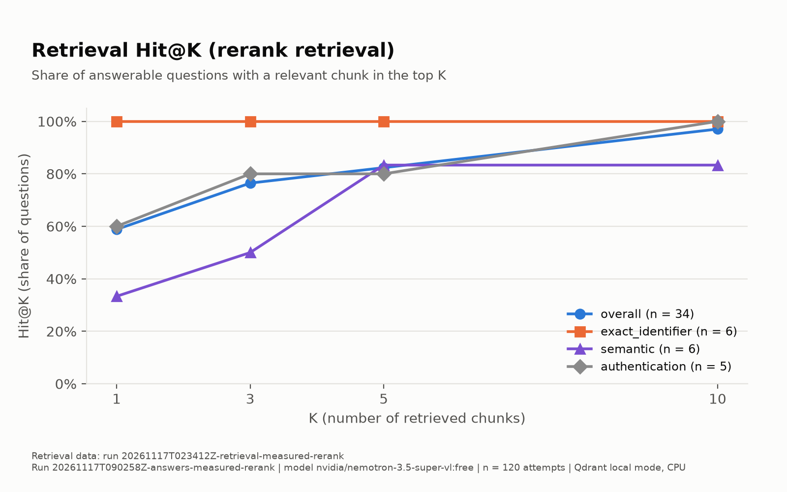
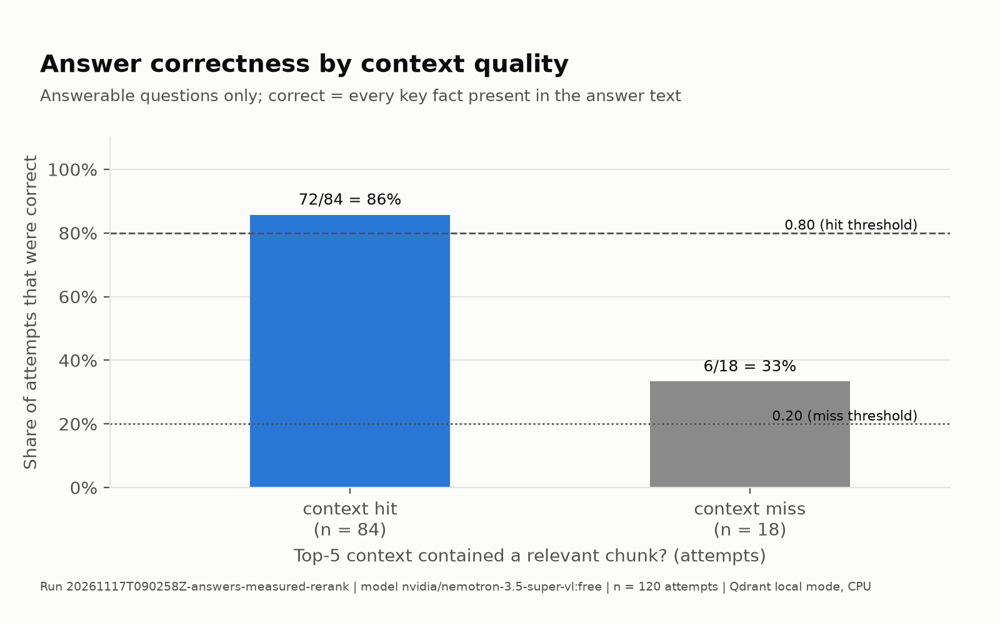
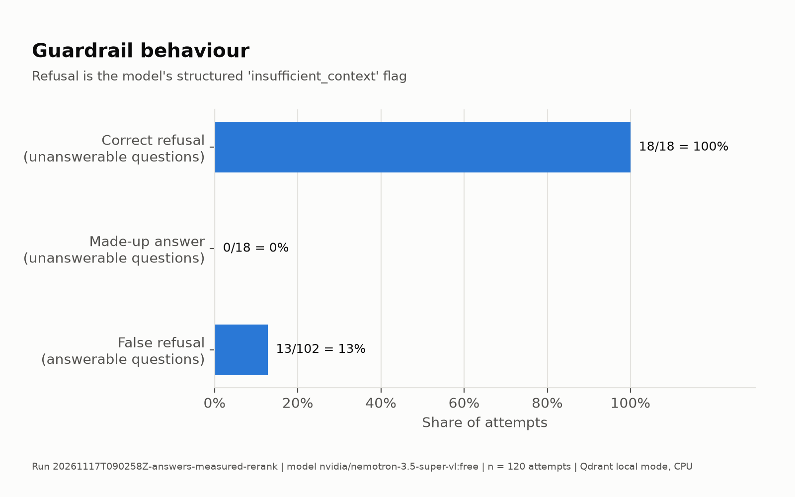
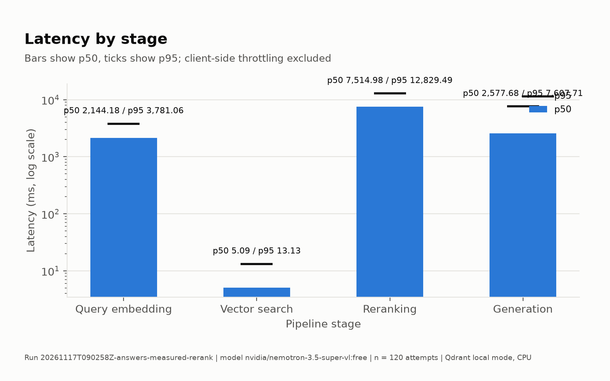
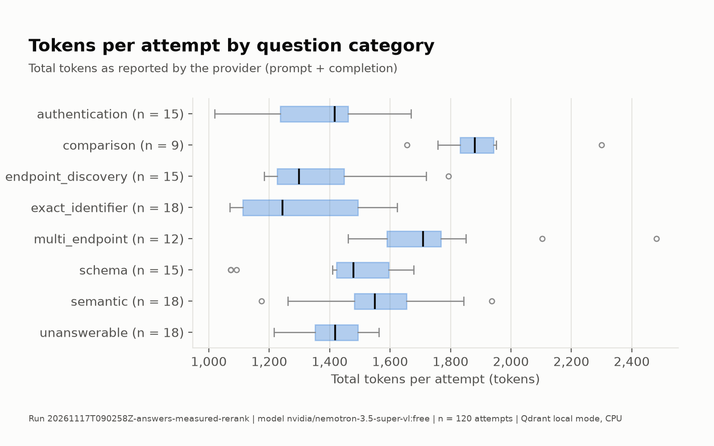

# Answer report: 20261117T090258Z-answers-measured-rerank

## Setup

- Corpus: version 1.0.0, checksum `72063d1be60b13a9e9a5105f04b081a161fa010cb11d210d0be3589b8726c0e6`
- Question set: measured, version 1.0.0, checksum `28d846ec119f105cbb6d6b36b5b00bda0dd7b7a1b16d4b43179c359f5432cede`
- Generation model: `nvidia/nemotron-3.5-super-vl:free` via openrouter; served by models ['nvidia/nemotron-3.5-super-vl:free'], providers ['Nvidia']
- Prompt: version a-1.0, hash `bc694d3da6e02137e4df755079dc355e99a1cf29506953c90c17631ac919abfc`
- Generation settings: {'prompt_version': 'a-1.0', 'temperature': 0.0, 'max_output_tokens': 16384, 'llm_seed': None, 'request_timeout_seconds': 300}
- Run settings: {'repetitions': 3, 'order_seed': 20261111, 'rate_limit_per_minute': 15, 'daily_request_cap': 900, 'canary_question_ids': ['Q01', 'Q05', 'Q14']}
- Retrieval: rerank, context = top 5 chunks; embedding `BAAI/bge-m3` revision `5617a9f61b028005a4858fdac845db406aefb181` (cpu); collection `lab-bank-c1-0-0-72063d1b-bge-m3-5617a9f6-m2400`; retrieval deterministic: True
- Run timing: started 2026-11-17 09:02:58 UTC, finished 2026-11-17 09:12:14 UTC
- Git: `1d42b91a41ef9aa52d2ef3b7890481e43ce720aa` (dirty: False); Python 3.12.12; macOS-15.0.1-arm64-arm-64bit
- Attempts: 120 planned, 120 completed, 0 unresolved infrastructure errors; halted: False

## Results

Infrastructure errors are excluded from every quality denominator below.

| group | n | answered | refused | invalid | cut off | correctness (answerable) | false refusal (answerable) | correct refusal (unanswerable) |
|---|---|---|---|---|---|---|---|---|
| overall | 120 | 89 | 31 | 0 | 0 | 78/102 = 0.765 | 13/102 = 0.127 | 18/18 = 1.000 |
| authentication | 15 | 15 | 0 | 0 | 0 | 12/15 = 0.800 | 0/15 = 0.000 | n/a (0) |
| comparison | 9 | 9 | 0 | 0 | 0 | 6/9 = 0.667 | 0/9 = 0.000 | n/a (0) |
| endpoint_discovery | 15 | 12 | 3 | 0 | 0 | 12/15 = 0.800 | 3/15 = 0.200 | n/a (0) |
| exact_identifier | 18 | 18 | 0 | 0 | 0 | 15/18 = 0.833 | 0/18 = 0.000 | n/a (0) |
| multi_endpoint | 12 | 6 | 6 | 0 | 0 | 6/12 = 0.500 | 6/12 = 0.500 | n/a (0) |
| schema | 15 | 15 | 0 | 0 | 0 | 14/15 = 0.933 | 0/15 = 0.000 | n/a (0) |
| semantic | 18 | 14 | 4 | 0 | 0 | 13/18 = 0.722 | 4/18 = 0.222 | n/a (0) |
| unanswerable | 18 | 0 | 18 | 0 | 0 | n/a (0) | n/a (0) | 18/18 = 1.000 |

## Hypotheses (frozen criteria, computed mechanically)

| hypothesis | criterion | verdict | evidence |
|---|---|---|---|
| HC3 | correct answerable attempts >= 80/102 | not supported | correct 78/102 = 0.765; architecture B: 78/102 |

## Guardrails

| measure | value |
|---|---|
| correct refusal (unanswerable) | 18/18 = 1.000 |
| made-up answer (unanswerable) | 0/18 = 0.000 |
| invalid answers on unanswerable attempts | 0 |
| cut-off answers on unanswerable attempts | 0 |
| false refusal (answerable) | 13/102 = 0.127 |
| diagnostic: unanswerable answers naming an endpoint (not scored) | 1 |

## Groundedness and citations

Identifiers only (endpoints, paths, error codes, scopes, headers, names); identifiers repeated from the question are not counted.

| measure | value |
|---|---|
| answers with at least one unsupported identifier | 0/120 = 0.000 |
| answers with at least one invented identifier | 0/120 = 0.000 |
| all cited ids were in the context (answered, must cite) | 89/89 = 1.000 |
| at least one cited id is relevant (answered, must cite) | 82/89 = 0.921 |

Most frequent unsupported identifiers: none

Most frequent invented identifiers: none

## Per question

| id | category | context hit | correct | outcomes | agree | missing key facts |
|---|---|---|---|---|---|---|
| Q101 | semantic | yes | 2/3 | answered, answered, answered | no | `VAL-001` |
| Q102 | semantic | yes | 3/3 | answered, answered, answered | yes | - |
| Q103 | exact_identifier | yes | 3/3 | answered, answered, answered | yes | - |
| Q104 | semantic | no | 0/3 | refused, refused, refused | yes | `/v1/statement-requests/{requestId}`, `Location` |
| Q105 | schema | yes | 3/3 | answered, answered, answered | yes | - |
| Q106 | schema | yes | 2/3 | answered, answered, answered | no | `pageSize` |
| Q107 | exact_identifier | yes | 3/3 | answered, answered, answered | yes | - |
| Q108 | semantic | yes | 2/3 | refused, answered, answered | no | `expires_in`, `seconds` |
| Q109 | exact_identifier | yes | 3/3 | answered, answered, answered | yes | - |
| Q110 | semantic | yes | 3/3 | answered, answered, answered | yes | - |
| Q111 | schema | yes | 3/3 | answered, answered, answered | yes | - |
| Q112 | semantic | yes | 3/3 | answered, answered, answered | yes | - |
| Q113 | schema | yes | 3/3 | answered, answered, answered | yes | - |
| Q114 | schema | yes | 3/3 | answered, answered, answered | yes | - |
| Q115 | exact_identifier | yes | 0/3 | answered, answered, answered | yes | `404` |
| Q116 | exact_identifier | yes | 3/3 | answered, answered, answered | yes | - |
| Q117 | exact_identifier | yes | 3/3 | answered, answered, answered | yes | - |
| Q118 | endpoint_discovery | yes | 3/3 | answered, answered, answered | yes | - |
| Q119 | endpoint_discovery | yes | 3/3 | answered, answered, answered | yes | - |
| Q120 | endpoint_discovery | no | 0/3 | refused, refused, refused | yes | `GET /v1/customers/{customerId}/consents` |
| Q121 | endpoint_discovery | yes | 3/3 | answered, answered, answered | yes | - |
| Q122 | endpoint_discovery | yes | 3/3 | answered, answered, answered | yes | - |
| Q123 | authentication | no | 3/3 | answered, answered, answered | yes | - |
| Q124 | authentication | yes | 3/3 | answered, answered, answered | yes | - |
| Q125 | authentication | yes | 3/3 | answered, answered, answered | yes | - |
| Q126 | authentication | yes | 3/3 | answered, answered, answered | yes | - |
| Q127 | authentication | yes | 0/3 | answered, answered, answered | yes | `statements:read` |
| Q128 | multi_endpoint | yes | 3/3 | answered, answered, answered | yes | - |
| Q129 | multi_endpoint | no | 0/3 | refused, refused, refused | yes | `GET /v1/accounts/{accountId}/balances`, `GET /v1/customers/{customerId}/accounts` |
| Q130 | multi_endpoint | no | 0/3 | refused, refused, refused | yes | `GET /v1/customers/{customerId}`, `PATCH /v1/customers/{customerId}/contact-details` |
| Q131 | multi_endpoint | no | 3/3 | answered, answered, answered | yes | - |
| Q132 | comparison | yes | 3/3 | answered, answered, answered | yes | - |
| Q133 | comparison | yes | 0/3 | answered, answered, answered | yes | `currency` |
| Q134 | comparison | yes | 3/3 | answered, answered, answered | yes | - |
| Q135 | unanswerable | no | 3/3 | refused, refused, refused | yes | - |
| Q136 | unanswerable | no | 3/3 | refused, refused, refused | yes | - |
| Q137 | unanswerable | no | 3/3 | refused, refused, refused | yes | - |
| Q138 | unanswerable | no | 3/3 | refused, refused, refused | yes | - |
| Q139 | unanswerable | no | 3/3 | refused, refused, refused | yes | - |
| Q140 | unanswerable | no | 3/3 | refused, refused, refused | yes | - |

For an unanswerable question 'correct' counts correct refusals.

## Latency

Qdrant local mode, in-process, exact search; CPU. Total = embed + search + rerank + generation, without client-side throttling. With few attempts p95 rests on a handful of observations.

| stage | n | p50 (ms) | p95 (ms) |
|---|---|---|---|
| embed | 120 | 2144.18 | 3781.06 |
| search | 120 | 5.09 | 13.13 |
| rerank | 120 | 7514.98 | 12829.49 |
| generation | 120 | 2577.68 | 7607.71 |
| total | 120 | 13198.54 | 23241.04 |

## Tokens and cost (estimated)

Tokens as reported by the provider.

| tokens | n | mean | p50 | p95 |
|---|---|---|---|---|
| prompt | 120 | 1083.9 | 1066.0 | 1322.1 |
| completion | 120 | 395.3 | 361.5 | 780.8 |
| total | 120 | 1479.2 | 1475.0 | 1899.9 |
| reasoning | 120 | 301.4 | 252.0 | 597.3 |

- Estimated cost per 1,000 questions: $0.3603 (estimated, not billed; pricing source: paid_variant). Estimated, not billed. Estimated at the paid variant's list price (nvidia/nemotron-3.5-super-vl) captured 2026-11-17
- Estimated cost of this run: $0.0432
- Requests: 121 sent, 1 failed, 1 retried; 0 infrastructure-error records

## Charts

## Limitations

- Small, synthetic, self-authored corpus and question set.
- A single generation model.
- Qdrant local-mode latency does not represent a Qdrant server.
- Free-model routing variance on OpenRouter.
- Deterministic groundedness covers identifiers only.
- BGE-M3 is larger than an English corpus of this size needs.
- The sample size is small, so results are per-question rather than statistically significant.
- This run: 120 attempts over 40 questions; 0 unresolved infrastructure errors; 0 invalid and 0 cut-off answers.

Author interpretation: see the experiment README.
