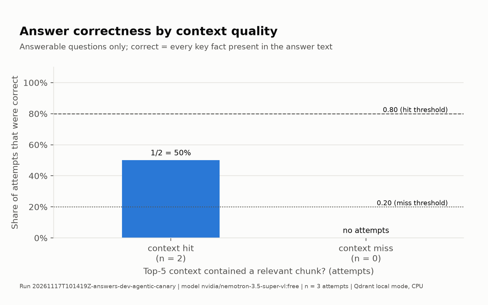
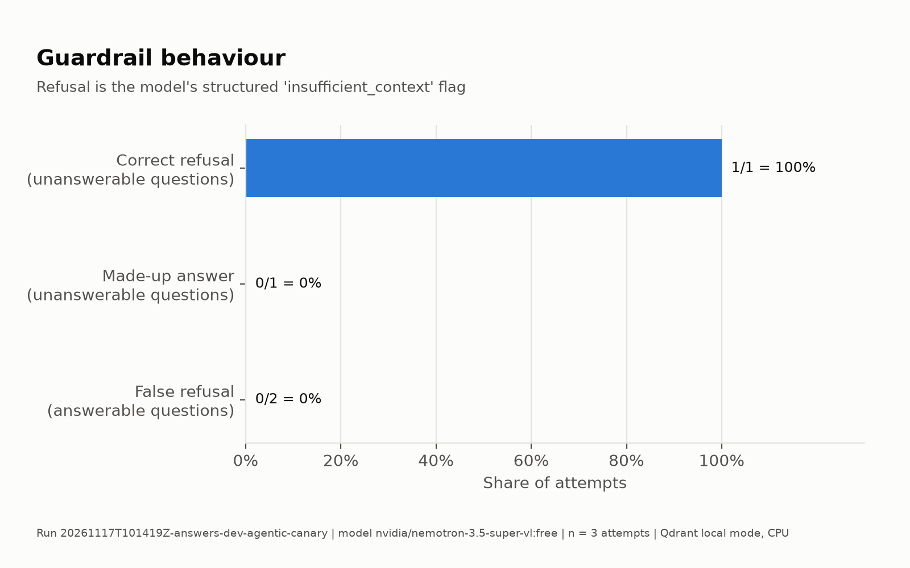
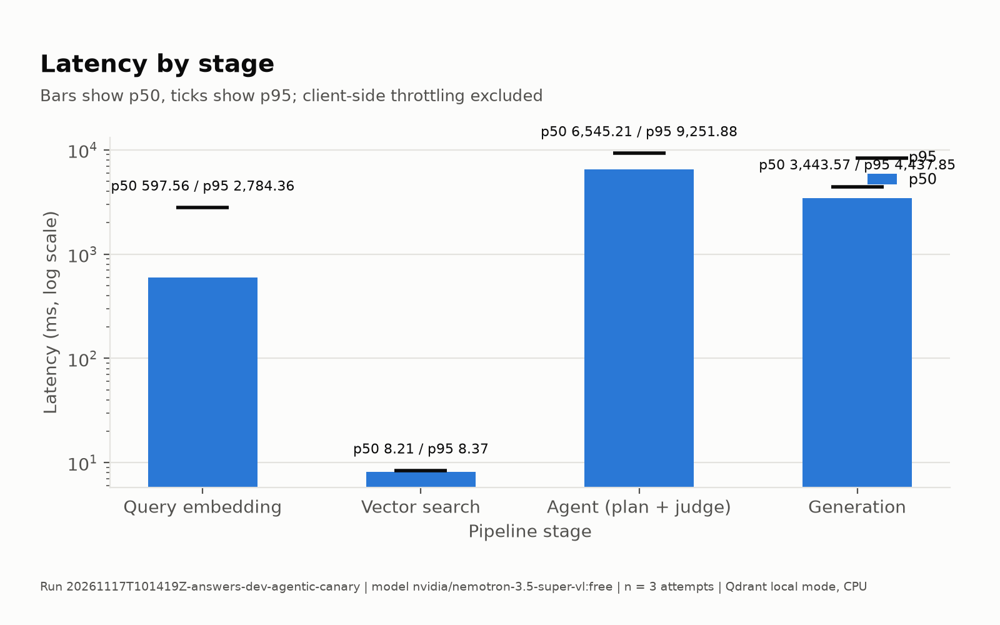
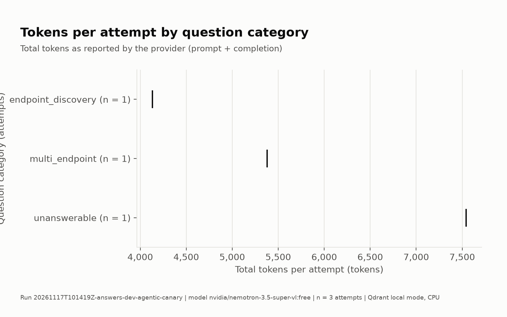

# Answer report: 20261117T101419Z-answers-dev-agentic-canary

## Setup

- Corpus: version 1.0.0, checksum `72063d1be60b13a9e9a5105f04b081a161fa010cb11d210d0be3589b8726c0e6`
- Question set: dev, version 0.1.0, checksum `9d9ab2a5a6dc6338cf0ddc1f3ff041a0da12b756a9a411f2bb4c2f11e6ca944b`; canary subset Q01, Q05, Q14
- Generation model: `nvidia/nemotron-3.5-super-vl:free` via openrouter; served by models ['nvidia/nemotron-3.5-super-vl:free'], providers ['Nvidia']
- Prompt: version a-1.0, hash `bc694d3da6e02137e4df755079dc355e99a1cf29506953c90c17631ac919abfc`
- Agent: {'prompt_version': 'd-1.0', 'max_searches': 3, 'results_per_search': 5, 'max_context_chunks': 10, 'max_planned_queries': 2, 'prompt_hash': '9e8b93edc35a9fd6c48f2ee17c6417a2fffb91c2e794100247076cdaa8f92ed1', 'search_tool': {'retriever': 'hybrid', 'bm25_k1': 1.2, 'bm25_b': 0.75, 'rrf_k': 60, 'candidate_depth': 50}}
- Generation settings: {'prompt_version': 'a-1.0', 'temperature': 0.0, 'max_output_tokens': 16384, 'llm_seed': None, 'request_timeout_seconds': 300}
- Run settings: {'repetitions': 1, 'order_seed': 20261111, 'rate_limit_per_minute': 15, 'daily_request_cap': 900, 'canary_question_ids': ['Q01', 'Q05', 'Q14']}
- Retrieval: agentic, context = up to 10 chunks; embedding `BAAI/bge-m3` revision `5617a9f61b028005a4858fdac845db406aefb181` (cpu); collection `lab-bank-c1-0-0-72063d1b-bge-m3-5617a9f6-m2400`; retrieval deterministic: False
- Run timing: started 2026-11-17 10:14:19 UTC, finished 2026-11-17 10:15:02 UTC
- Git: `1d28c43bd06e844a5409204e5a3a7d17eba0cc2a` (dirty: False); Python 3.12.12; macOS-15.0.1-arm64-arm-64bit
- Attempts: 3 planned, 3 completed, 0 unresolved infrastructure errors; halted: False

## Results

Infrastructure errors are excluded from every quality denominator below.

| group | n | answered | refused | invalid | cut off | correctness (answerable) | false refusal (answerable) | correct refusal (unanswerable) |
|---|---|---|---|---|---|---|---|---|
| overall | 3 | 2 | 1 | 0 | 0 | 1/2 = 0.500 | 0/2 = 0.000 | 1/1 = 1.000 |
| endpoint_discovery | 1 | 1 | 0 | 0 | 0 | 1/1 = 1.000 | 0/1 = 0.000 | n/a (0) |
| multi_endpoint | 1 | 1 | 0 | 0 | 0 | 0/1 = 0.000 | 0/1 = 0.000 | n/a (0) |
| unanswerable | 1 | 0 | 1 | 0 | 0 | n/a (0) | n/a (0) | 1/1 = 1.000 |

## Hypotheses (frozen criteria, computed mechanically)

| hypothesis | criterion | verdict | evidence |
|---|---|---|---|
| HD1 | multi_endpoint attempts whose collected context covers every labelled source >= 9/12 | not applicable (development set) | full source coverage 0/1 = 0.000; architecture B: 3/12 |
| HD2 | correct answerable attempts >= 80/102 | not applicable (development set) | correct 1/2 = 0.500; architecture B: 78/102 |
| HD3 | correct refusals on unanswerable attempts >= 17/18 | not applicable (development set) | correct refusals 1/1 = 1.000; architecture B: 18/18 |

## Guardrails

| measure | value |
|---|---|
| correct refusal (unanswerable) | 1/1 = 1.000 |
| made-up answer (unanswerable) | 0/1 = 0.000 |
| invalid answers on unanswerable attempts | 0 |
| cut-off answers on unanswerable attempts | 0 |
| false refusal (answerable) | 0/2 = 0.000 |
| diagnostic: unanswerable answers naming an endpoint (not scored) | 1 |

## Groundedness and citations

Identifiers only (endpoints, paths, error codes, scopes, headers, names); identifiers repeated from the question are not counted.

| measure | value |
|---|---|
| answers with at least one unsupported identifier | 0/3 = 0.000 |
| answers with at least one invented identifier | 0/3 = 0.000 |
| all cited ids were in the context (answered, must cite) | 2/2 = 1.000 |
| at least one cited id is relevant (answered, must cite) | 2/2 = 1.000 |

Most frequent unsupported identifiers: none

Most frequent invented identifiers: none

## Per question

| id | category | context hit | correct | outcomes | agree | missing key facts |
|---|---|---|---|---|---|---|
| Q01 | endpoint_discovery | yes | 1/1 | answered | yes | - |
| Q05 | multi_endpoint | yes | 0/1 | answered | yes | `POST /oauth/token` |
| Q14 | unanswerable | no | 1/1 | refused | yes | - |

For an unanswerable question 'correct' counts correct refusals.

## Agent behaviour

Scored attempts: 3. Retrieval is chosen by the model, so it can differ between repetitions; each attempt is scored on the context it collected.

| per attempt | mean | p50 | max |
|---|---|---|---|
| model calls | 3.33 | 3.0 | 4 |
| searches | 2.33 | 2.0 | 3 |
| context chunks | 9.33 | - | 10 |

Model calls per attempt:

| value | attempts |
|---|---|
| 3 | 2 |
| 4 | 1 |
| 5 | 0 |

Searches per attempt:

| value | attempts |
|---|---|
| 1 | 0 |
| 2 | 2 |
| 3 | 1 |

| planner and judge | value |
|---|---|
| planner reported needs_retrieval = false | 0 |
| plan replies that could not be used (fell back to the question) | 0 |
| judge replies that could not be parsed (counted as enough) | 0 |
| first judge decision was enough | 2/3 = 0.667 |

Attempts whose collected context covers every labelled source, by category (answerable attempts):

| category | full source coverage |
|---|---|
| endpoint_discovery | 1/1 attempts |
| multi_endpoint | 0/1 attempts |

Queries run in repetition 1 for each multi_endpoint question (model output):

- Q05: `list customer accounts`, `download account statement`

## Latency

Qdrant local mode, in-process, exact search; CPU. Total = embed + search + agent (planner and judge calls) + generation, without client-side throttling. With few attempts p95 rests on a handful of observations.

| stage | n | p50 (ms) | p95 (ms) |
|---|---|---|---|
| embed | 3 | 597.56 | 2784.36 |
| search | 3 | 8.21 | 8.37 |
| agent | 3 | 6545.21 | 9251.88 |
| generation | 3 | 3443.57 | 4437.85 |
| total | 3 | 13602.15 | 14076.39 |

## Tokens and cost (estimated)

Tokens as reported by the provider.

| tokens | n | mean | p50 | p95 |
|---|---|---|---|---|
| prompt | 3 | 4382.7 | 4067.0 | 5375.6 |
| completion | 3 | 1302.7 | 1314.0 | 1949.4 |
| total | 3 | 5685.3 | 5381.0 | 7325.0 |
| reasoning | 3 | 1081.7 | 1109.0 | 1613.9 |

- Estimated cost per 1,000 questions: $1.3087 (estimated, not billed; pricing source: paid_variant). Estimated, not billed. Estimated at the paid variant's list price (nvidia/nemotron-3.5-super-vl) captured 2026-11-17
- Estimated cost of this run: $0.0039
- Requests: 10 sent, 0 failed, 0 retried; 0 infrastructure-error records

## Charts

## Limitations

- Small, synthetic, self-authored corpus and question set.
- A single generation model.
- Qdrant local-mode latency does not represent a Qdrant server.
- Free-model routing variance on OpenRouter.
- Deterministic groundedness covers identifiers only.
- BGE-M3 is larger than an English corpus of this size needs.
- The sample size is small, so results are per-question rather than statistically significant.
- This run: 3 attempts over 3 questions; 0 unresolved infrastructure errors; 0 invalid and 0 cut-off answers.

Author interpretation: see the experiment README.
