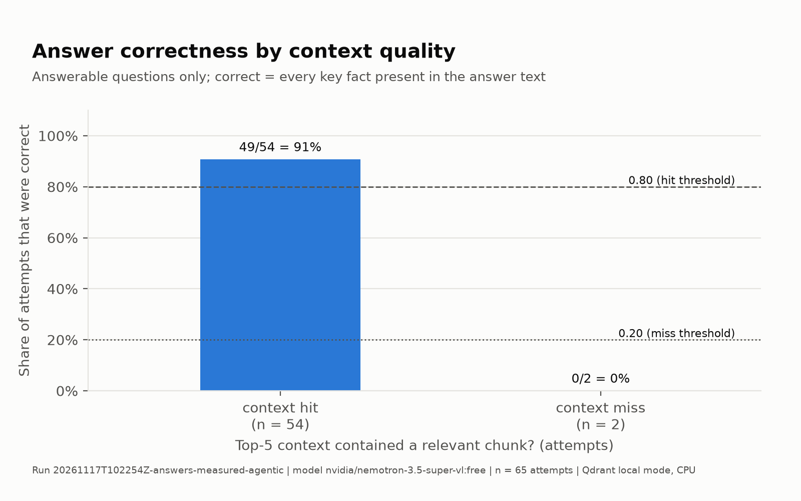
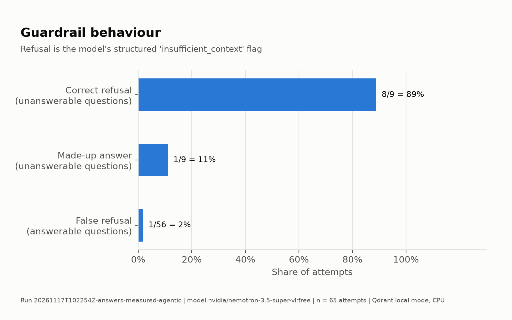
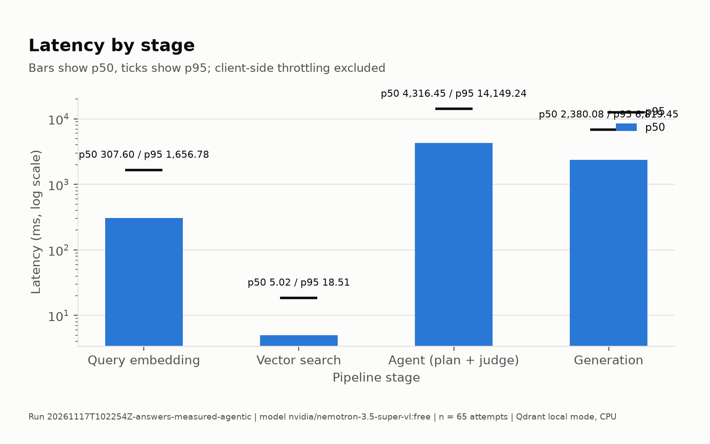
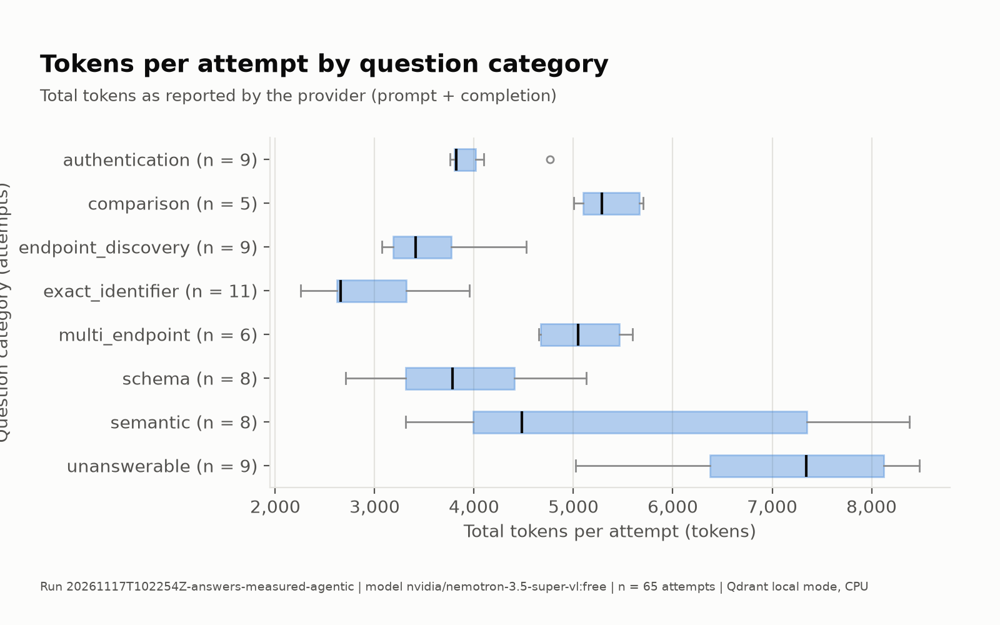

# Answer report: 20261117T102254Z-answers-measured-agentic

## Setup

- Corpus: version 1.0.0, checksum `72063d1be60b13a9e9a5105f04b081a161fa010cb11d210d0be3589b8726c0e6`
- Question set: measured, version 1.0.0, checksum `28d846ec119f105cbb6d6b36b5b00bda0dd7b7a1b16d4b43179c359f5432cede`
- Generation model: `nvidia/nemotron-3.5-super-vl:free` via openrouter; served by models ['nvidia/nemotron-3.5-super-vl:free'], providers ['Nvidia']
- Prompt: version a-1.0, hash `bc694d3da6e02137e4df755079dc355e99a1cf29506953c90c17631ac919abfc`
- Agent: {'prompt_version': 'd-1.0', 'max_searches': 3, 'results_per_search': 5, 'max_context_chunks': 10, 'max_planned_queries': 2, 'prompt_hash': '9e8b93edc35a9fd6c48f2ee17c6417a2fffb91c2e794100247076cdaa8f92ed1', 'search_tool': {'retriever': 'hybrid', 'bm25_k1': 1.2, 'bm25_b': 0.75, 'rrf_k': 60, 'candidate_depth': 50}}
- Generation settings: {'prompt_version': 'a-1.0', 'temperature': 0.0, 'max_output_tokens': 16384, 'llm_seed': None, 'request_timeout_seconds': 300}
- Run settings: {'repetitions': 3, 'order_seed': 20261111, 'rate_limit_per_minute': 15, 'daily_request_cap': 900, 'canary_question_ids': ['Q01', 'Q05', 'Q14']}
- Retrieval: agentic, context = up to 10 chunks; embedding `BAAI/bge-m3` revision `5617a9f61b028005a4858fdac845db406aefb181` (cpu); collection `lab-bank-c1-0-0-72063d1b-bge-m3-5617a9f6-m2400`; retrieval deterministic: False
- Run timing: started 2026-11-17 10:22:54 UTC, finished 2026-11-17 17:37:09 UTC
- Git: `0b1ff66434fe17d45751334f89d5dbedbe009f01` (dirty: False); Python 3.12.12; macOS-15.0.1-arm64-arm-64bit
- Attempts: 120 planned, 65 completed, 0 unresolved infrastructure errors; halted: True (interrupted (Ctrl-C))

## Results

Infrastructure errors are excluded from every quality denominator below.

| group | n | answered | refused | invalid | cut off | correctness (answerable) | false refusal (answerable) | correct refusal (unanswerable) |
|---|---|---|---|---|---|---|---|---|
| overall | 65 | 56 | 9 | 0 | 0 | 49/56 = 0.875 | 1/56 = 0.018 | 8/9 = 0.889 |
| authentication | 9 | 9 | 0 | 0 | 0 | 7/9 = 0.778 | 0/9 = 0.000 | n/a (0) |
| comparison | 5 | 5 | 0 | 0 | 0 | 5/5 = 1.000 | 0/5 = 0.000 | n/a (0) |
| endpoint_discovery | 9 | 9 | 0 | 0 | 0 | 9/9 = 1.000 | 0/9 = 0.000 | n/a (0) |
| exact_identifier | 11 | 11 | 0 | 0 | 0 | 9/11 = 0.818 | 0/11 = 0.000 | n/a (0) |
| multi_endpoint | 6 | 6 | 0 | 0 | 0 | 5/6 = 0.833 | 0/6 = 0.000 | n/a (0) |
| schema | 8 | 8 | 0 | 0 | 0 | 8/8 = 1.000 | 0/8 = 0.000 | n/a (0) |
| semantic | 8 | 7 | 1 | 0 | 0 | 6/8 = 0.750 | 1/8 = 0.125 | n/a (0) |
| unanswerable | 9 | 1 | 8 | 0 | 0 | n/a (0) | n/a (0) | 8/9 = 0.889 |

## Hypotheses (frozen criteria, computed mechanically)

| hypothesis | criterion | verdict | evidence |
|---|---|---|---|
| HD1 | multi_endpoint attempts whose collected context covers every labelled source >= 9/12 | not testable | full source coverage 4/6 = 0.667; architecture B: 3/12; expected 12 attempts, found 6 |
| HD2 | correct answerable attempts >= 80/102 | not testable | correct 49/56 = 0.875; architecture B: 78/102; expected 102 attempts, found 56 |
| HD3 | correct refusals on unanswerable attempts >= 17/18 | not testable | correct refusals 8/9 = 0.889; architecture B: 18/18; expected 18 attempts, found 9 |

## Guardrails

| measure | value |
|---|---|
| correct refusal (unanswerable) | 8/9 = 0.889 |
| made-up answer (unanswerable) | 1/9 = 0.111 |
| invalid answers on unanswerable attempts | 0 |
| cut-off answers on unanswerable attempts | 0 |
| false refusal (answerable) | 1/56 = 0.018 |
| diagnostic: unanswerable answers naming an endpoint (not scored) | 1 |

## Groundedness and citations

Identifiers only (endpoints, paths, error codes, scopes, headers, names); identifiers repeated from the question are not counted.

| measure | value |
|---|---|
| answers with at least one unsupported identifier | 0/65 = 0.000 |
| answers with at least one invented identifier | 0/65 = 0.000 |
| all cited ids were in the context (answered, must cite) | 55/55 = 1.000 |
| at least one cited id is relevant (answered, must cite) | 54/55 = 0.982 |

Most frequent unsupported identifiers: none

Most frequent invented identifiers: none

## Per question

| id | category | context hit | correct | outcomes | agree | missing key facts |
|---|---|---|---|---|---|---|
| Q101 | semantic | no | 0/1 | answered | yes | `VAL-001` |
| Q102 | semantic | yes | 1/1 | answered | yes | - |
| Q103 | exact_identifier | yes | 2/2 | answered, answered | yes | - |
| Q104 | semantic | no | 0/1 | refused | yes | `/v1/statement-requests/{requestId}`, `Location` |
| Q105 | schema | yes | 1/1 | answered | yes | - |
| Q106 | schema | yes | 2/2 | answered, answered | yes | - |
| Q107 | exact_identifier | yes | 2/2 | answered, answered | yes | - |
| Q108 | semantic | yes | 2/2 | answered, answered | yes | - |
| Q109 | exact_identifier | yes | 1/1 | answered | yes | - |
| Q110 | semantic | yes | 2/2 | answered, answered | yes | - |
| Q111 | schema | yes | 2/2 | answered, answered | yes | - |
| Q112 | semantic | yes | 1/1 | answered | yes | - |
| Q113 | schema | yes | 1/1 | answered | yes | - |
| Q114 | schema | yes | 2/2 | answered, answered | yes | - |
| Q115 | exact_identifier | yes | 0/2 | answered, answered | yes | `404` |
| Q116 | exact_identifier | yes | 2/2 | answered, answered | yes | - |
| Q117 | exact_identifier | yes | 2/2 | answered, answered | yes | - |
| Q118 | endpoint_discovery | yes | 1/1 | answered | yes | - |
| Q119 | endpoint_discovery | yes | 2/2 | answered, answered | yes | - |
| Q120 | endpoint_discovery | yes | 2/2 | answered, answered | yes | - |
| Q121 | endpoint_discovery | yes | 2/2 | answered, answered | yes | - |
| Q122 | endpoint_discovery | yes | 2/2 | answered, answered | yes | - |
| Q123 | authentication | yes | 2/2 | answered, answered | yes | - |
| Q124 | authentication | yes | 1/1 | answered | yes | - |
| Q125 | authentication | yes | 2/2 | answered, answered | yes | - |
| Q126 | authentication | yes | 2/2 | answered, answered | yes | - |
| Q127 | authentication | yes | 0/2 | answered, answered | yes | `statements:read` |
| Q128 | multi_endpoint | yes | 2/2 | answered, answered | yes | - |
| Q129 | multi_endpoint | yes | 2/2 | answered, answered | yes | - |
| Q130 | multi_endpoint | yes | 0/1 | answered | yes | `GET /v1/customers/{customerId}` |
| Q131 | multi_endpoint | yes | 1/1 | answered | yes | - |
| Q132 | comparison | yes | 2/2 | answered, answered | yes | - |
| Q133 | comparison | yes | 1/1 | answered | yes | - |
| Q134 | comparison | yes | 2/2 | answered, answered | yes | - |
| Q135 | unanswerable | no | 1/1 | refused | yes | - |
| Q136 | unanswerable | no | 2/2 | refused, refused | yes | - |
| Q137 | unanswerable | no | 2/2 | refused, refused | yes | - |
| Q138 | unanswerable | no | 0/1 | answered | yes | - |
| Q139 | unanswerable | no | 1/1 | refused | yes | - |
| Q140 | unanswerable | no | 2/2 | refused, refused | yes | - |

For an unanswerable question 'correct' counts correct refusals.

## Agent behaviour

Scored attempts: 65. Retrieval is chosen by the model, so it can differ between repetitions; each attempt is scored on the context it collected.

| per attempt | mean | p50 | max |
|---|---|---|---|
| model calls | 3.22 | 3.0 | 5 |
| searches | 2.15 | 2.0 | 3 |
| context chunks | 7.71 | - | 10 |

Model calls per attempt:

| value | attempts |
|---|---|
| 3 | 52 |
| 4 | 12 |
| 5 | 1 |

Searches per attempt:

| value | attempts |
|---|---|
| 1 | 3 |
| 2 | 49 |
| 3 | 13 |

| planner and judge | value |
|---|---|
| planner reported needs_retrieval = false | 0 |
| plan replies that could not be used (fell back to the question) | 0 |
| judge replies that could not be parsed (counted as enough) | 0 |
| first judge decision was enough | 52/65 = 0.800 |

Attempts whose collected context covers every labelled source, by category (answerable attempts):

| category | full source coverage |
|---|---|
| authentication | 9/9 attempts |
| comparison | 5/5 attempts |
| endpoint_discovery | 9/9 attempts |
| exact_identifier | 11/11 attempts |
| multi_endpoint | 4/6 attempts |
| schema | 8/8 attempts |
| semantic | 6/8 attempts |

Queries run in repetition 1 for each multi_endpoint question (model output):

- Q131: `find customer by last name`, `customer consents endpoint`
- Q130: `change customer email address endpoint`, `confirm email address change endpoint`, `confirm email address change verify endpoint customers-api`
- Q129: `list customer accounts endpoint`, `read account balance endpoint`
- Q128: `cancel payment`, `payment status`

## Latency

Qdrant local mode, in-process, exact search; CPU. Total = embed + search + agent (planner and judge calls) + generation, without client-side throttling. With few attempts p95 rests on a handful of observations.

| stage | n | p50 (ms) | p95 (ms) |
|---|---|---|---|
| embed | 65 | 307.60 | 1656.78 |
| search | 65 | 5.02 | 18.51 |
| agent | 65 | 4316.45 | 14149.24 |
| generation | 65 | 2380.08 | 6819.45 |
| total | 65 | 8347.25 | 17956.77 |

## Tokens and cost (estimated)

Tokens as reported by the provider.

| tokens | n | mean | p50 | p95 |
|---|---|---|---|---|
| prompt | 65 | 3488.2 | 3234.0 | 5760.2 |
| completion | 65 | 1063.7 | 877.0 | 2092.8 |
| total | 65 | 4551.9 | 4097.0 | 8065.0 |
| reasoning | 65 | 903.5 | 721.0 | 1796.8 |

- Estimated cost per 1,000 questions: $1.0551 (estimated, not billed; pricing source: paid_variant). Estimated, not billed. Estimated at the paid variant's list price (nvidia/nemotron-3.5-super-vl) captured 2026-11-17
- Estimated cost of this run: $0.0686
- Requests: 210 sent, 1 failed, 1 retried; 0 infrastructure-error records

## Charts

## Limitations

- Small, synthetic, self-authored corpus and question set.
- A single generation model.
- Qdrant local-mode latency does not represent a Qdrant server.
- Free-model routing variance on OpenRouter.
- Deterministic groundedness covers identifiers only.
- BGE-M3 is larger than an English corpus of this size needs.
- The sample size is small, so results are per-question rather than statistically significant.
- This run: 65 attempts over 40 questions; 0 unresolved infrastructure errors; 0 invalid and 0 cut-off answers.

Author interpretation: see the experiment README.
