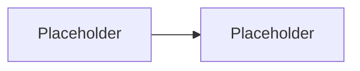

# NN — <Experiment Title>

> **Status:** Not started | In progress | Complete
> **Experiment version:** 0.1.0
> **Last updated:** YYYY-MM-DD

## 1. Overview

_One paragraph: what is being compared or explored, and how._

## 2. Research Question

_A single, testable question._

## 3. Why This Matters

_The real-world engineering relevance._

## 4. Hypothesis

_Explicit, falsifiable hypotheses. Mark each as unverified until tested._

## 5. Objectives

_What the experiment sets out to learn or demonstrate._

## 6. Scope

### In scope

_What is covered._

### Out of scope

_What is deliberately excluded._

## 7. Architecture

_Describe the design. Link to `architecture/overview.md` for detail._

## 8. Implementation Approaches

_The approaches being compared and how they differ._

## 9. Technology Stack

_Languages, libraries, tools and why each was chosen._

## 10. Experimental Methodology

_Dataset, iterations, warm-up, concurrency, environment and how metrics are collected._

## 11. Evaluation Metrics

_Which metrics apply, their units and definitions. Label estimated metrics as estimated._

## 12. Results

> Results pending. Do not fill in until benchmarks have been run.

## 13. Analysis

> Results pending. Do not fill in until benchmarks have been run.

## 14. Limitations

_Threats to validity and known constraints._

## 15. Conclusion

> Results pending. Do not fill in until benchmarks have been run.

## 16. How to Run

_Exact commands to reproduce the results._

## 17. References

_Sources, with links._
